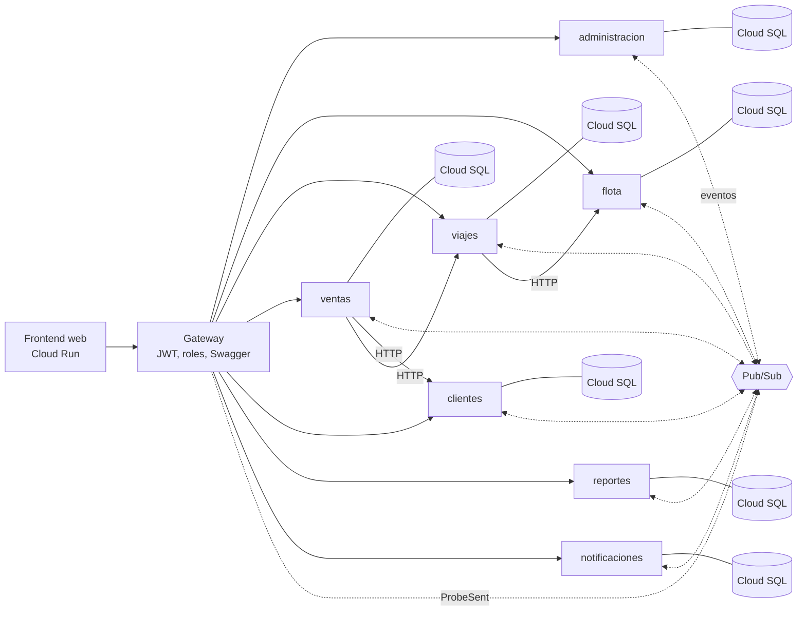
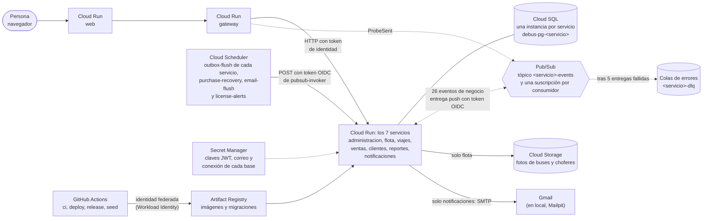
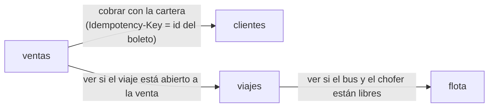

# Manuales técnicos de debus

Plataforma de transporte extraurbano de Guatemala. El frontend habla solo con el **gateway**, que verifica la sesión y reenvía cada pedido al servicio dueño del dato; cada servicio tiene su propia base en Cloud SQL y se enteran unos de otros por **eventos de Pub/Sub** (solo unas pocas consultas son llamadas HTTP directas).

## Direcciones de producción

- **Aplicación:** <https://web-169401355798.us-central1.run.app/>
- **Swagger:** <https://gateway-avqapfieaa-uc.a.run.app/docs>, con los siete servicios unidos. Los datos para probar los endpoints protegidos se piden a un administrador.

## Manuales

| Servicio       | Para qué sirve                                                                          | Manual                                     |
| -------------- | --------------------------------------------------------------------------------------- | ------------------------------------------ |
| gateway        | Puerta pública: sesión, roles, enrutamiento y Swagger unido                             | [gateway](gateway/README.md)               |
| administracion | Cuentas, sesiones, sucursales, configuración y gastos de taller                         | [administracion](administracion/README.md) |
| flota          | Buses, choferes, rutas y disponibilidad                                                 | [flota](flota/README.md)                   |
| viajes         | Viajes, salida y llegada, y bus y chofer de los alquileres pagados                      | [viajes](viajes/README.md)                 |
| ventas         | Boletos, asientos, la compra con cartera (saga) y la venta de ventanilla                | [ventas](ventas/README.md)                 |
| clientes       | Perfil, cartera digital y alquileres de buses                                           | [clientes](clientes/README.md)             |
| reportes       | Los 12 reportes (6 de sucursal y 6 del sistema) con exportación a PDF                   | [reportes](reportes/README.md)             |
| notificaciones | Correos de cuentas, boletos, cancelaciones, cartera y alquileres, y alertas de licencia | [notificaciones](notificaciones/README.md) |

Cada manual explica para qué sirve el servicio, sus componentes, sus clases, sus tablas, su despliegue, los eventos que publica y consume, sus endpoints, sus variables de entorno y cómo probarlo. Los diagramas de clases, de tablas y de despliegue, los eventos y los endpoints **se generan** del código con `pnpm run docs` (y `pnpm run docs --check` en la integración continua los compara); el diagrama de componentes se escribe a mano.

## Diagrama de despliegue general

Todo corre en un solo proyecto de Google Cloud. Los siete servicios, el gateway y el web son un Cloud Run cada uno; cada servicio tiene su propia instancia de Cloud SQL (`debus-pg-<servicio>`), su tópico de Pub/Sub (`<servicio>-events`) y su cola de errores (`<servicio>-dlq`). El detalle de cada servicio (sus suscripciones y sus trabajos) está en la sección "Diagrama de despliegue" de su manual.

Las únicas llamadas HTTP entre servicios son tres, cada una con su circuit breaker; todo lo demás va por eventos (26 eventos de negocio contra 3 llamadas: 89.7 % por eventos).

- **Qué se despliega.** `deploy.yml` construye una imagen por unidad (más una de migración por servicio) y la sube a Artifact Registry; `release.yml` las publica en Cloud Run, corre la migración de cada base como un Cloud Run Job y crea los trabajos de Cloud Scheduler.
- **Secretos.** Las claves del JWT, las credenciales de Gmail y la conexión de cada base viven en Secret Manager y llegan a Cloud Run como variables; nunca están en el repositorio.
- **Entornos.** En local (`pnpm local`) el mismo esquema corre con PostgreSQL, el emulador de Pub/Sub, un servidor de archivos para las fotos y Mailpit; sin autenticación entre servicios.

## Manejo de fallos entre servicios

- **Eventos**: outbox transaccional en el servicio que publica, inbox idempotente (`processed_events`) en el que consume, reintentos de Pub/Sub y cola de errores tras 5 entregas fallidas.
- **Circuit breaker**: las llamadas HTTP síncronas (`ventas→clientes`, `ventas→viajes` y `viajes→flota`) pasan por `ServiceHttpClient`, que lleva un breaker por servicio destino. Tras 5 intentos fallidos seguidos se abre 30 segundos y las llamadas fallan al instante con un `503`; pasado ese tiempo deja pasar una llamada de prueba. Cada `/health` informa sus circuitos y `/admin/estado` los muestra.
- **Saga de compra con la cartera (orquestada, `ventas`)**: tres pasos con nombre: T1 reservar los asientos (compensable), T2 cobrar a `clientes` (el **pivote**, con `Idempotency-Key` igual al id del boleto) y T3 confirmar y publicar `TicketSold` (reintentable); C1 libera los asientos si el cobro se rechaza y el job `purchase-recovery` resuelve lo que queda en duda. Se cuenta en el manual de [ventas](ventas/README.md#saga-de-compra).
- **Saga de reembolso por un viaje eliminado (coreografiada)**: `TripDeleted` lleva a `RefundRequested` y a `WalletCredited`, en cuatro pasos (S1 a S4) solo con eventos, con una marca contra el cobro tardío. Está en el manual de [ventas](ventas/README.md#viaje-eliminado-y-reembolso).
- **Saga de cancelación de un alquiler pagado (coreografiada)**: el pivote está en `viajes` y `clientes` y `reportes` aplican `RentalCancelled` hasta lograrlo. Está en el manual de [clientes](clientes/README.md#saga-de-cancelación-de-un-alquiler-pagado-coreografiada).

## Otros entregables

- **Swagger**: `/docs` en el gateway, con los siete servicios unidos ([producción](https://gateway-avqapfieaa-uc.a.run.app/docs); `http://localhost:4000/docs` en local).
- **Colección Postman**: [`postman/debus.postman_collection.json`](../postman/debus.postman_collection.json), generada del Swagger (`pnpm postman`) con un recorrido de uso.
- **Datos de demostración**: [`datos-de-prueba.md`](datos-de-prueba.md).

## Repositorios por unidad

Además del monorepo, cada unidad (`gateway`, los siete servicios y `web`) tiene su propio repositorio, `rrobertobt/sa-debus-<unidad>`, con el historial de sus archivos y los paquetes compartidos que usa. Cada repositorio compila y corre sus pruebas por sí solo (`pnpm install --frozen-lockfile && pnpm build && pnpm test`); el despliegue y las pruebas de integración se hacen desde el monorepo.

| Unidad         | Repositorio                                                                                 | Manual                                     |
| -------------- | ------------------------------------------------------------------------------------------- | ------------------------------------------ |
| gateway        | [rrobertobt/sa-debus-gateway](https://github.com/rrobertobt/sa-debus-gateway)               | [gateway](gateway/README.md)               |
| administracion | [rrobertobt/sa-debus-administracion](https://github.com/rrobertobt/sa-debus-administracion) | [administracion](administracion/README.md) |
| flota          | [rrobertobt/sa-debus-flota](https://github.com/rrobertobt/sa-debus-flota)                   | [flota](flota/README.md)                   |
| viajes         | [rrobertobt/sa-debus-viajes](https://github.com/rrobertobt/sa-debus-viajes)                 | [viajes](viajes/README.md)                 |
| ventas         | [rrobertobt/sa-debus-ventas](https://github.com/rrobertobt/sa-debus-ventas)                 | [ventas](ventas/README.md)                 |
| clientes       | [rrobertobt/sa-debus-clientes](https://github.com/rrobertobt/sa-debus-clientes)             | [clientes](clientes/README.md)             |
| reportes       | [rrobertobt/sa-debus-reportes](https://github.com/rrobertobt/sa-debus-reportes)             | [reportes](reportes/README.md)             |
| notificaciones | [rrobertobt/sa-debus-notificaciones](https://github.com/rrobertobt/sa-debus-notificaciones) | [notificaciones](notificaciones/README.md) |
| web            | [rrobertobt/sa-debus-web](https://github.com/rrobertobt/sa-debus-web)                       | —                                          |
