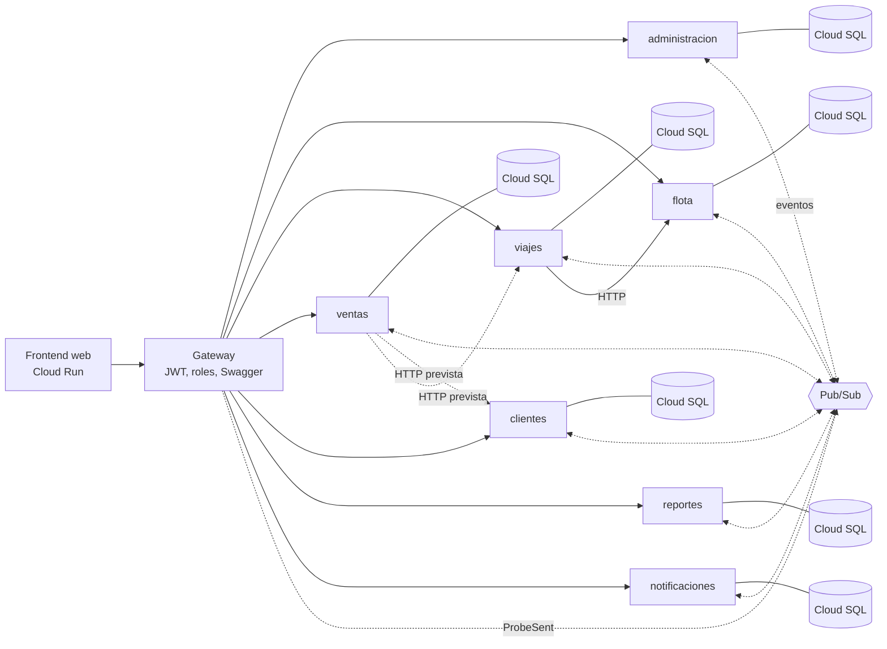

# Manuales técnicos de debus

Plataforma de transporte extraurbano de Guatemala. El frontend habla solo con el **gateway**, que verifica la sesión y reenvía cada pedido al servicio dueño del dato; cada servicio tiene su propia base en Cloud SQL y se enteran unos de otros por **eventos de Pub/Sub** (solo unas pocas consultas son llamadas HTTP directas).

## Manuales

| Servicio       | Para qué sirve                                                                                        | Manual                                     |
| -------------- | ----------------------------------------------------------------------------------------------------- | ------------------------------------------ |
| gateway        | Puerta pública: sesión, roles, enrutamiento y Swagger unido                                           | [gateway](gateway/README.md)               |
| administracion | Cuentas, sesiones, sucursales, configuración y gastos de taller                                       | [administracion](administracion/README.md) |
| flota          | Buses, choferes, rutas y disponibilidad                                                               | [flota](flota/README.md)                   |
| viajes         | Viajes, salida y llegada, alquileres                                                                  | [viajes](viajes/README.md)                 |
| ventas         | Boletos, asientos y la saga de compra (en desarrollo)                                                 | [ventas](ventas/)                          |
| clientes       | Perfil y cartera digital (en desarrollo)                                                              | [clientes](clientes/)                      |
| reportes       | Reportes con exportación a PDF (los de sucursal ya existen; los del admin del sistema, en desarrollo) | [reportes](reportes/)                      |
| notificaciones | Correos de cuentas (los de boletos, alquileres y licencias, en desarrollo)                            | [notificaciones](notificaciones/)          |

Cada manual explica para qué sirve el servicio, sus componentes, sus tablas, su despliegue, los eventos que publica y consume, sus endpoints, sus variables de entorno y cómo probarlo. Los diagramas de tablas, de despliegue, los eventos y los endpoints **se generan** del código con `pnpm run docs` (y `pnpm run docs --check` en la integración continua los compara); el diagrama de componentes se escribe a mano.

## Otros entregables

- **Swagger**: `/docs` en el gateway, con los siete servicios unidos.
- **Colección Postman**: [`postman/debus.postman_collection.json`](../postman/debus.postman_collection.json), generada del Swagger (`pnpm postman`) con un recorrido de uso.
- **Datos de demostración**: [`datos-de-prueba.md`](datos-de-prueba.md).
