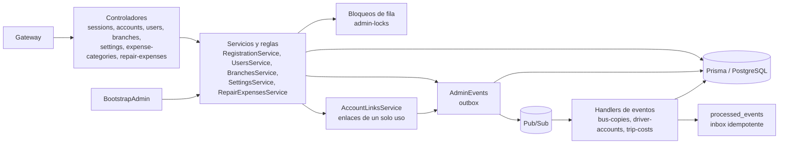
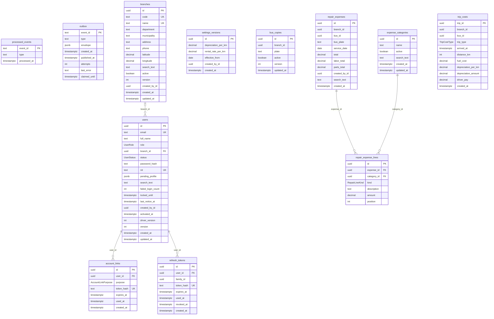
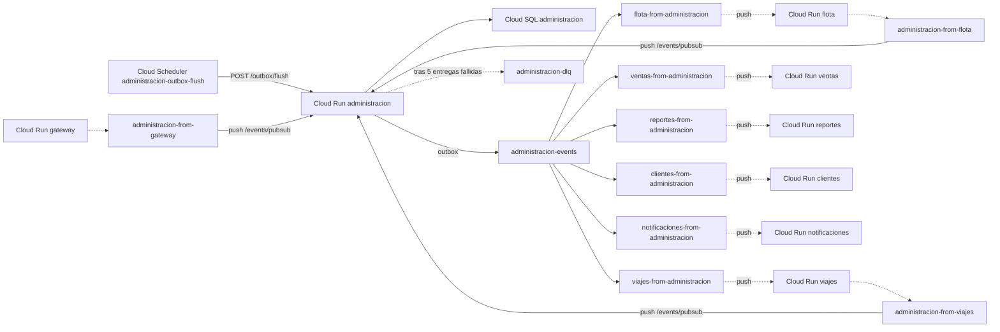

# Manual técnico · Administración

En producción: [aplicación](https://web-169401355798.us-central1.run.app/) · [Swagger](https://gateway-avqapfieaa-uc.a.run.app/docs) (datos para los endpoints protegidos: pedirlos a un administrador).

**Repositorio:** [rrobertobt/sa-debus-administracion](https://github.com/rrobertobt/sa-debus-administracion) (monorepo: [JeffMenca/debus](https://github.com/JeffMenca/debus)).

**Administración** es dueña de las cuentas y de la configuración de la empresa: usuarios y sesiones, sucursales, la configuración vigente (depreciación y tarifa de alquiler), el catálogo de categorías de gasto y los gastos de taller.

## 1. Para qué sirve y qué reglas cumple

- **Cuentas y sesiones.** Los usuarios se invitan o se registran (clientes) y activan su cuenta con un enlace de un solo uso (48 h para activar, 1 h para restablecer; hasta 3 correos por hora). Las contraseñas se guardan con hash y el acceso es un JWT de 15 minutos más un token de refresco de 7 días que **rota en cada uso**; 5 intentos fallidos bloquean la cuenta 15 minutos. Los usuarios se desactivan, nunca se borran, y siempre queda al menos un admin del sistema activo y un admin por sucursal activa (se protege con bloqueos de fila, también cuando alguien se mueve de sucursal).
- **Sucursales.** Se crean con su primer administrador, con coordenadas dentro de Guatemala; se desactivan sin borrar. Cada cambio publica `BranchCreated` o `BranchUpdated`. `GET /branches/locations` (público) entrega solo `id`, nombre, municipio, departamento y coordenadas de las activas. Las rutas internas `POST /internal/branches/republish` y `POST /internal/settings/republish` (solo entre servicios, con token de identidad) vuelven a publicar el estado actual para los servicios que empiezan a guardar copias.
- **Configuración.** Cada versión (depreciación por km, tarifa de alquiler, fecha de vigencia) es inmutable (la protege un trigger); la vigente en una fecha es la última que empieza ese día o antes. Se publica como `SettingsUpdated`.
- **Gastos de taller.** Catálogo de categorías (solo el admin del sistema; el nombre es único sin distinguir mayúsculas, con un índice de la migración que el diagrama de tablas no dibuja; una categoría con gastos solo se desactiva) y gastos con líneas de mano de obra y repuestos. El `id` lo elige el cliente, así que repetir el envío devuelve el primero. Publica `RepairExpenseAdded`.
- **Copias por eventos.** Mantiene la copia de los buses (`BusAdded`, `BusUpdated`, `BusDeactivated`), las cuentas de los choferes (`DriverAdded`, `DriverUpdated`) y los costos de cada viaje (`TripCompleted`).
- **Primer admin.** Si no hay administradores, crea el de `BOOTSTRAP_ADMIN_EMAIL` y le manda la invitación.

## 2. Diagrama de componentes



## 2.1 Diagrama de clases

Controladores, servicios y sus dependencias, agrupados por carpeta. Se genera del código con `pnpm run docs`.

```mermaid
classDiagram
  namespace accounts {
    class AccountEvents {
      +flush()
      +linkSent()
      +userRegistered()
      +userUpdated()
    }
    class AccountLinksService {
      +find()
      +issue()
      +noticeAlreadyRegistered()
      +writeLink()
    }
    class AccountsController {
      +forgot()
      +renew()
      +setPassword()
      +signUp()
      +status()
    }
    class RegistrationService {
      +forgotPassword()
      +linkStatus()
      +renewLink()
      +setPassword()
      +signUp()
    }
  }
  namespace branches {
    class BranchesController {
      +create()
      +deactivate()
      +get()
      +list()
      +locations()
      +reactivate()
      +update()
    }
    class BranchesService {
      +create()
      +get()
      +list()
      +locations()
      +setActive()
      +update()
    }
    class BranchRepublishController {
      +republish()
    }
    class BranchRepublishService {
      +republish()
    }
  }
  namespace common {
    class AdminEvents {
      +branchChanged()
      +flush()
      +repairExpenseAdded()
      +settingsUpdated()
    }
  }
  namespace drivers {
    class DriverAccountsHandler {
      +added()
      +updated()
    }
  }
  namespace expenses {
    class CategoriesController {
      +create()
      +list()
      +remove()
      +update()
    }
    class CategoriesService {
      +create()
      +list()
      +remove()
      +update()
    }
    class RepairExpensesController {
      +create()
      +get()
      +list()
    }
    class RepairExpensesService {
      +create()
      +get()
      +list()
    }
    class TripCostsHandler {
      +completed()
    }
  }
  namespace fleet {
    class BusCopiesHandler {
      +added()
      +deactivated()
      +updated()
    }
  }
  namespace health {
    class HealthController {
      +check()
    }
  }
  namespace prisma {
    class PrismaService
  }
  namespace sessions {
    class AccessTokensService {
      +sign()
    }
    class SessionsController {
      +login()
      +logout()
      +me()
      +refresh()
    }
    class SessionsService {
      +login()
      +logout()
      +me()
      +refresh()
    }
  }
  namespace settings {
    class SettingsController {
      +create()
      +list()
    }
    class SettingsRepublishController {
      +republish()
    }
    class SettingsRepublishService {
      +republish()
    }
    class SettingsService {
      +create()
      +list()
    }
  }
  namespace users {
    class BootstrapAdmin {
      +ensureSystemAdmin()
    }
    class UserRepublishController {
      +republish()
    }
    class UserRepublishService {
      +republish()
    }
    class UsersController {
      +create()
      +deactivate()
      +get()
      +list()
      +reactivate()
      +resendInvitation()
      +update()
    }
    class UsersService {
      +create()
      +deactivate()
      +get()
      +list()
      +reactivate()
      +resendInvitation()
      +update()
    }
  }
  AccountLinksService --> AccountEvents
  AccountLinksService --> PrismaService
  AccountsController --> RegistrationService
  BootstrapAdmin --> AccountLinksService
  BootstrapAdmin --> PrismaService
  BranchesController --> BranchesService
  BranchesService --> AccountLinksService
  BranchesService --> AdminEvents
  BranchesService --> PrismaService
  BranchRepublishController --> BranchRepublishService
  BranchRepublishService --> AdminEvents
  BranchRepublishService --> PrismaService
  BusCopiesHandler --> PrismaService
  CategoriesController --> CategoriesService
  CategoriesService --> PrismaService
  DriverAccountsHandler --> AccountLinksService
  DriverAccountsHandler --> PrismaService
  RegistrationService --> AccountEvents
  RegistrationService --> AccountLinksService
  RegistrationService --> PrismaService
  RepairExpensesController --> RepairExpensesService
  RepairExpensesService --> AdminEvents
  RepairExpensesService --> PrismaService
  SessionsController --> SessionsService
  SessionsService --> AccessTokensService
  SessionsService --> PrismaService
  SettingsController --> SettingsService
  SettingsRepublishController --> SettingsRepublishService
  SettingsRepublishService --> AdminEvents
  SettingsRepublishService --> PrismaService
  SettingsService --> AdminEvents
  SettingsService --> PrismaService
  TripCostsHandler --> PrismaService
  UserRepublishController --> UserRepublishService
  UserRepublishService --> AccountEvents
  UserRepublishService --> PrismaService
  UsersController --> UsersService
  UsersService --> AccountEvents
  UsersService --> AccountLinksService
  UsersService --> PrismaService
```

<!-- prettier-ignore-start -->
<!-- generado:clases -->

<!-- /generado:clases -->
<!-- prettier-ignore-end -->

## 3. Diagrama de tablas

Administración guarda las cuentas, las sucursales, la configuración, el catálogo de gastos y los gastos de taller, más las copias de buses y los costos de viaje que llegan por eventos, y las tablas del outbox y del inbox.

<!-- prettier-ignore-start -->
<!-- generado:tablas -->

<!-- /generado:tablas -->
<!-- prettier-ignore-end -->

## 4. Diagrama de despliegue

Cada servicio corre en su propio Cloud Run; los eventos viajan por Pub/Sub y las pocas llamadas síncronas por HTTP con el token de identidad de la cuenta de servicio.

<!-- prettier-ignore-start -->
<!-- generado:despliegue -->

<!-- /generado:despliegue -->
<!-- prettier-ignore-end -->

## 5. Eventos y manejo de fallos

Los eventos se escriben en la tabla `outbox` en la **misma transacción** que el cambio y un job de Cloud Scheduler (`administracion-outbox-flush`, cada minuto) y el propio servicio los publican; cada entrega que llega pasa por la tabla `processed_events`, así que procesar dos veces el mismo `eventId` no repite nada. Pub/Sub reintenta con espera y, tras 5 intentos fallidos, deja el mensaje en `administracion-dlq` (con su suscripción `administracion-dlq-sub`), que el admin del sistema puede revisar, reenviar o descartar desde `/dead-letters`.

<!-- prettier-ignore-start -->
<!-- generado:eventos -->
**Publica**

| Evento | Lo consumen |
| --- | --- |
| `BranchCreated` | flota, viajes, ventas, reportes, clientes |
| `BranchUpdated` | flota, viajes, ventas, reportes, clientes |
| `SettingsUpdated` | viajes, clientes, reportes |
| `UserRegistered` | clientes, notificaciones |
| `AccountLinkSent` | notificaciones |
| `RepairExpenseAdded` | reportes |
| `UserUpdated` | notificaciones, clientes |

**Consume**

| Evento | Lo publica |
| --- | --- |
| `BusAdded` | flota |
| `BusUpdated` | flota |
| `BusDeactivated` | flota |
| `DriverAdded` | flota |
| `DriverUpdated` | flota |
| `TripCompleted` | viajes |
| `ProbeSent` | gateway |
<!-- /generado:eventos -->
<!-- prettier-ignore-end -->

## 6. Endpoints

Todas las rutas pasan por el gateway con el prefijo `/api/administracion` (aquí aparecen sin él). El detalle de cada cuerpo y respuesta está en el Swagger del gateway (`/docs`; en local, `http://localhost:4000/docs`) y en la colección [`postman/debus.postman_collection.json`](../../postman/debus.postman_collection.json).

<!-- prettier-ignore-start -->
<!-- generado:endpoints -->
| Método | Ruta | Qué hace | Roles |
| --- | --- | --- | --- |
| `POST` | `/auth/links/renew` | Envía un enlace nuevo | Público |
| `POST` | `/auth/links/status` | Dice si un enlace sirve, venció o ya se usó | Público |
| `POST` | `/auth/login` | Inicia sesión | Público |
| `POST` | `/auth/logout` | Cierra la sesión | Público |
| `GET` | `/auth/me` | Devuelve la cuenta de la sesión | Cualquier sesión |
| `POST` | `/auth/password` | Guarda la contraseña con el enlace recibido | Público |
| `POST` | `/auth/password/forgot` | Envía el enlace para crear o restablecer la contraseña | Público |
| `POST` | `/auth/refresh` | Renueva la sesión | Público |
| `POST` | `/auth/signup` | Registra a un cliente y le envía el enlace para crear su contraseña | Público |
| `GET` | `/branches` | Lista las sucursales | Cualquier sesión |
| `POST` | `/branches` | Crea una sucursal con su primer administrador | SYSTEM_ADMIN |
| `GET` | `/branches/locations` | Lista dónde están las sucursales activas, para el mapa de la página de inicio | Público |
| `GET` | `/branches/{id}` | Consulta una sucursal | Cualquier sesión |
| `PATCH` | `/branches/{id}` | Cambia los datos de una sucursal | SYSTEM_ADMIN |
| `POST` | `/branches/{id}/deactivate` | Desactiva una sucursal | SYSTEM_ADMIN |
| `POST` | `/branches/{id}/reactivate` | Reactiva una sucursal | SYSTEM_ADMIN |
| `GET` | `/dead-letters` | Lista los mensajes que fallaron y quedaron en la cola de errores | SYSTEM_ADMIN |
| `DELETE` | `/dead-letters/{messageId}` | Descarta un mensaje de la cola de errores | SYSTEM_ADMIN |
| `POST` | `/dead-letters/{messageId}/replay` | Vuelve a entregar un mensaje de la cola de errores | SYSTEM_ADMIN |
| `GET` | `/expense-categories` | Lista las categorías de gasto | SYSTEM_ADMIN, BRANCH_ADMIN |
| `POST` | `/expense-categories` | Crea una categoría de gasto | SYSTEM_ADMIN |
| `PATCH` | `/expense-categories/{id}` | Cambia el nombre de una categoría, la desactiva o la reactiva | SYSTEM_ADMIN |
| `DELETE` | `/expense-categories/{id}` | Elimina una categoría que no tiene gastos | SYSTEM_ADMIN |
| `GET` | `/health` | Responde si el servicio está en línea | Cualquier sesión |
| `GET` | `/repair-expenses` | Lista los gastos de taller | BRANCH_ADMIN |
| `POST` | `/repair-expenses` | Registra un gasto de taller con sus líneas | BRANCH_ADMIN |
| `GET` | `/repair-expenses/{id}` | Consulta un gasto de taller | BRANCH_ADMIN |
| `GET` | `/settings` | Lista las versiones de la configuración y cuál está vigente | SYSTEM_ADMIN |
| `POST` | `/settings` | Crea una versión nueva de la configuración | SYSTEM_ADMIN |
| `GET` | `/users` | Lista las cuentas | SYSTEM_ADMIN, BRANCH_ADMIN |
| `POST` | `/users` | Invita a una cuenta nueva | SYSTEM_ADMIN, BRANCH_ADMIN |
| `GET` | `/users/{id}` | Consulta una cuenta | SYSTEM_ADMIN, BRANCH_ADMIN |
| `PATCH` | `/users/{id}` | Cambia el nombre o la sucursal de una cuenta | SYSTEM_ADMIN |
| `POST` | `/users/{id}/deactivate` | Desactiva una cuenta | SYSTEM_ADMIN |
| `POST` | `/users/{id}/invitation` | Reenvía la invitación de una cuenta pendiente | SYSTEM_ADMIN, BRANCH_ADMIN |
| `POST` | `/users/{id}/reactivate` | Reactiva una cuenta | SYSTEM_ADMIN |
<!-- /generado:endpoints -->
<!-- prettier-ignore-end -->

## 7. Variables de entorno

Las que recibe en Cloud Run salen de `cloudRunEnv` (`packages/contracts/src/cloud-run-env.ts`); en local las trae `services/administracion/.env.example`.

| Variable                | Para qué sirve                                                                                        |
| ----------------------- | ----------------------------------------------------------------------------------------------------- |
| `PORT`                  | Puerto en el que escucha (el de su `.env.example` en local; Cloud Run lo asigna en producción).       |
| `SERVICE_NAME`          | Nombre del servicio; lo fija el despliegue y el código no lo lee.                                     |
| `DEBUS_ENV`             | `local` o `production`.                                                                               |
| `PUBSUB_PROJECT_ID`     | Proyecto de Pub/Sub (en local, el del emulador `debus-local`).                                        |
| `PUBSUB_AUDIENCE`       | Dirección del servicio: el token OIDC que Pub/Sub manda en cada entrega debe estar emitido para ella. |
| `PUBSUB_PUSH_SA`        | Cuenta de servicio que Pub/Sub usa para entregar; solo ella puede llamar a `POST /events/pubsub`.     |
| `PUBSUB_EMULATOR_HOST`  | Solo en local: con él no se valida el token de Pub/Sub.                                               |
| `DATABASE_URL`          | Conexión a la base del servicio (en producción la arma el despliegue).                                |
| `DB_POOL_MAX`           | Conexiones máximas al pool (2 en Cloud Run, para no agotar Cloud SQL).                                |
| `WEB_URL`               | Dirección del frontend, para los enlaces de los correos.                                              |
| `BOOTSTRAP_ADMIN_EMAIL` | Correo del primer admin del sistema.                                                                  |
| `JWT_PRIVATE_KEY`       | Clave privada con la que se firman los tokens de acceso.                                              |

## 8. Cómo correrlo y probarlo

```bash
pnpm install
pnpm local                                   # todo el stack: PostgreSQL, Pub/Sub, Mailpit, apps y migraciones
pnpm --filter @debus/administracion test              # pruebas unitarias con cobertura (mínimo 85 %)
pnpm --filter @debus/administracion test:integration  # contra PostgreSQL y el emulador de Pub/Sub (mínimo 65 %)
```

La cuenta del primer admin se crea sola al arrancar (`admin@debus.local` en local).

Las pruebas que escriben datos usan correos `@debus.test` y el prefijo `Prueba ` y los borran al terminar; `pnpm test:clean` quita lo que haya quedado.
