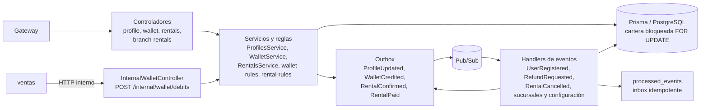
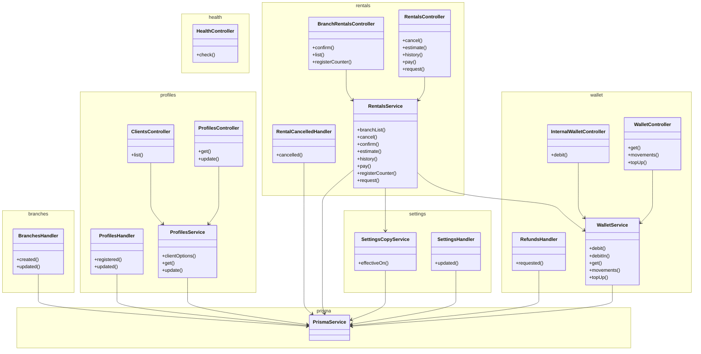
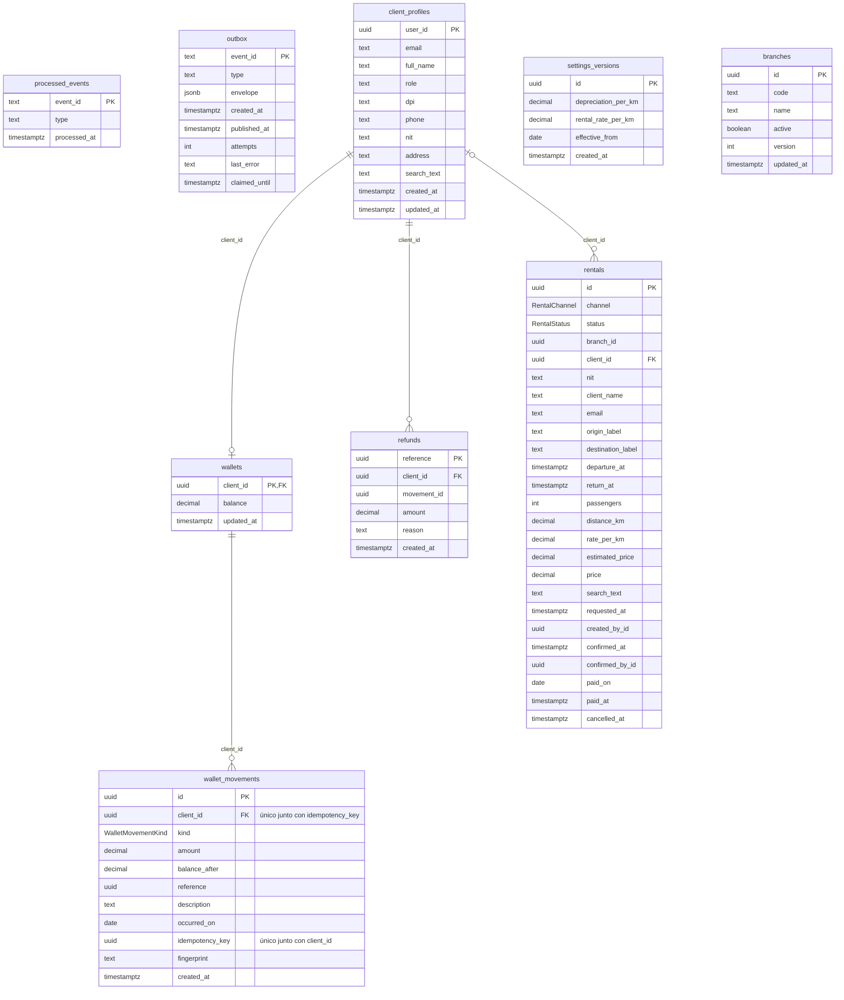
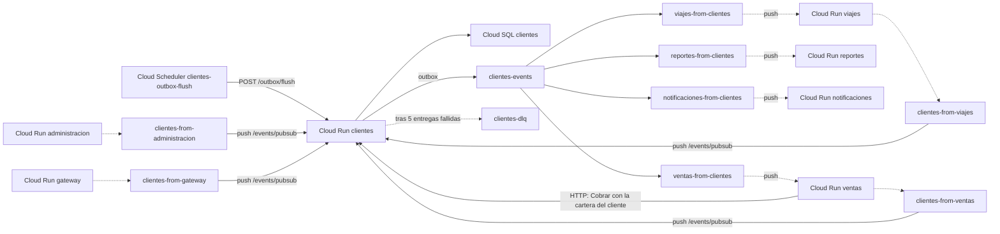

# Manual técnico · Clientes

En producción: [aplicación](https://web-169401355798.us-central1.run.app/) · [Swagger](https://gateway-avqapfieaa-uc.a.run.app/docs) (datos para los endpoints protegidos: pedirlos a un administrador).

**Repositorio:** [rrobertobt/sa-debus-clientes](https://github.com/rrobertobt/sa-debus-clientes) (monorepo: [JeffMenca/debus](https://github.com/JeffMenca/debus)).

**Clientes** guarda el perfil de cada persona, su **cartera digital** y los **alquileres de buses**. Es el único servicio que mueve dinero de la cartera: `ventas` le pide cobrar un boleto y `clientes` decide, con la cartera bloqueada, si se puede.

## 1. Para qué sirve y qué reglas cumple

- **Perfil.** Una fila por cuenta, creada cuando `administracion` publica `UserRegistered` (el personal también tiene una, con los datos de cliente vacíos) o, si ese evento se perdió, cuando llega `UserUpdated` de una cuenta activa que no tiene perfil (ver [Recuperar perfiles](#recuperar-perfiles)). La persona puede cambiar su DPI, teléfono, NIT y dirección (`PUT /profile`); eso publica `ProfileUpdated`, que `ventas` copia para vincular las ventas de ventanilla por NIT. El NIT es único entre los perfiles que lo tienen (`409` "ya está en otra cuenta").
- **Cartera.** Una por perfil, creada junto con él. El saldo **nunca es negativo** (restricción `wallets_balance_non_negative`) y cada movimiento (`TOP_UP`, `TICKET`, `RENTAL`, `REFUND`) guarda el saldo que dejó. Cada operación de dinero lleva un `Idempotency-Key` y su combinación con la cartera es única: repetirla responde lo mismo y **nunca mueve el dinero dos veces**; la misma clave con otros datos responde 409.
- **Recargar.** `POST /wallet/top-ups` con la clave y `paidOn` (la fecha de pago, que se puede elegir; hasta Q100,000). Publica `WalletCredited` y `notificaciones` manda el correo.
- **Cobrar.** `POST /internal/wallet/debits` es solo entre servicios (`ventas` lo llama con la clave igual al id del boleto). Bloquea la cartera, revisa si ese cobro ya se aplicó (y entonces responde lo mismo), si el viaje se canceló y se devolvió el boleto (`422`), si ya pasó el plazo `payBy` (`422`) y si alcanza el saldo (`422`).
- **Devolver.** Al recibir `RefundRequested`, devuelve lo que cobró ese boleto o deja la marca que rechaza un cobro tardío (detalle en la saga de reembolso, abajo).
- **Alquileres.** Se piden en línea o se registran en ventanilla, se confirman con un precio, se pagan con la cartera y se cancelan; el cliente ve su historial. Los estados, el precio y las reglas están en [Alquileres](#alquileres).
- **Copias por eventos.** Guarda la copia de las sucursales (`BranchCreated`, `BranchUpdated`) y de la configuración vigente (`SettingsUpdated`, para la tarifa por km), siempre por versión.

### Alquileres

Un alquiler vive en la tabla `rentals` de `clientes`. Puede ser **en línea** (`ONLINE`), pedido por un cliente con cuenta, o **de ventanilla** (`COUNTER`), registrado por el admin de sucursal para un cliente existente, que elige con `GET /clients`. El NIT (`CF` si no tiene), el nombre y el correo salen de su perfil. Solo las filas de ventanilla anteriores a este cambio no tienen cliente.

| Estado      | Qué significa                                                                                 | Lo ve el cliente como     | Lo ve la sucursal como |
| ----------- | --------------------------------------------------------------------------------------------- | ------------------------- | ---------------------- |
| `REQUESTED` | El cliente lo pidió; tiene precio estimado                                                    | Esperando precio          | Por confirmar          |
| `CONFIRMED` | La sucursal fijó el precio                                                                    | Precio listo, falta pagar | Esperando pago         |
| `PAID`      | Se pagó con la cartera (en filas antiguas sin cliente, en efectivo) y se publicó `RentalPaid` | Pagado                    | Pagado                 |
| `CANCELLED` | Se canceló antes o después de pagar                                                           | Cancelado                 | Cancelado              |

- **Precio estimado**: km que escribe el cliente × tarifa por km vigente ese día (copia local de `SettingsUpdated`). La tarifa queda guardada en el alquiler (`rate_per_km`), así un cambio de configuración no mueve el estimado.
- **Sucursal**: `clientes` guarda una copia de las sucursales (tabla `branches`, alimentada por `BranchCreated` y `BranchUpdated`). Un alquiler en línea solo se pide a una sucursal que existe y está activa; si no, responde 422.
- **Confirmación**: solo desde `REQUESTED` y antes de la salida (después responde 422, porque ese precio ya no se podría pagar). El admin puede corregir los km (importan para la depreciación del bus en `viajes`) y deja el estimado o escribe otro precio. Si es en línea, publica `RentalConfirmed` y `notificaciones` manda "Tu cotización está lista".
- **Ventanilla**: se registra ya `CONFIRMED`, con el precio acordado ahí, y publica `RentalConfirmed` en la misma transacción para avisarle al cliente por correo. Lo paga el cliente con su cartera desde su cuenta (`POST /rentals/{id}/pay`), porque nadie más puede gastar ese saldo. El admin solo cobra en efectivo las filas antiguas sin cliente.
- **Historial**: un cliente ve los alquileres a su nombre y las filas antiguas de ventanilla sin cliente hechas con el NIT de su perfil (nunca con `CF`). Se consulta en el momento, sin copiar filas, así sigue al NIT si el cliente lo cambia.

#### Pago con la cartera: una transacción, no una saga

El débito, el paso a `PAID` y el evento `RentalPaid` (por outbox) se escriben **en una sola transacción** de la base de `clientes`: o pasa todo o no pasa nada. Por eso no hace falta saga ni compensación.

- `Idempotency-Key` = id del alquiler. Un reintento encuentra el alquiler ya `PAID` y responde lo mismo; con otra fecha de pago responde 409.
- El alquiler se bloquea (`SELECT … FOR UPDATE`) antes de cobrar, así pagos simultáneos, una confirmación o una cancelación del mismo alquiler se aplican uno tras otro. Una prueba lanza 20 pagos a la vez y exige un solo movimiento y un solo `RentalPaid`.
- No se paga un alquiler cuya salida ya pasó.

## 2. Diagrama de componentes



## 2.1 Diagrama de clases

Controladores, servicios y sus dependencias, agrupados por carpeta. Se genera del código con `pnpm run docs`.

<!-- prettier-ignore-start -->
<!-- generado:clases -->

<!-- /generado:clases -->
<!-- prettier-ignore-end -->

## 3. Diagrama de tablas

Clientes guarda los perfiles, las carteras con sus movimientos, las devoluciones, los alquileres y las copias de sucursales y configuración, más las tablas del outbox y del inbox. La clave `(client_id, idempotency_key)` de `wallet_movements` y la clave primaria de `refunds` (una devolución por referencia) son lo que impide mover dinero dos veces.

<!-- prettier-ignore-start -->
<!-- generado:tablas -->

<!-- /generado:tablas -->
<!-- prettier-ignore-end -->

## 4. Diagrama de despliegue

Cada servicio corre en su propio Cloud Run con su propia base en Cloud SQL; los eventos viajan por Pub/Sub. `clientes` recibe la única llamada síncrona de `ventas` que mueve dinero.

<!-- prettier-ignore-start -->
<!-- generado:despliegue -->

<!-- /generado:despliegue -->
<!-- prettier-ignore-end -->

## 5. Eventos y manejo de fallos

El outbox se escribe en la misma transacción que el cambio (la recarga, el cobro, el pago del alquiler) y lo publican el job `clientes-outbox-flush` (cada minuto) y el propio servicio al terminar la petición; el inbox (`processed_events`) evita procesar dos veces una entrega; Pub/Sub reintenta y, tras 5 fallos, deja el mensaje en `clientes-dlq`.

**Qué pasa si `clientes` no responde.** `clientes` no llama a nadie, así que no tiene circuit breaker propio: es el **destino** del de `ventas` (véase [ventas](../ventas/README.md#circuit-breaker)). Si el cobro no llega, `ventas` deja la compra en duda y la recupera con la misma clave; por eso el cobro repetido responde lo mismo en vez de cobrar otra vez.

### Saga de compra con la cartera: el pivote vive aquí

La saga de compra es **orquestada** por `ventas` (detalle en su manual). El paso **T2, el pivote**, es el cobro de `clientes`: se aplica en una sola transacción con la cartera bloqueada y es idempotente por `Idempotency-Key` (el id del boleto). Una vez que pudo aplicarse ya no se deshace desde `ventas`: si el boleto se pierde (viaje eliminado), la **compensación del cobro** es la devolución de la saga coreografiada de abajo.

### Saga de reembolso por viaje eliminado: el paso S3

Es la saga coreografiada de [ventas](../ventas/README.md#viaje-eliminado-y-reembolso). Aquí vive su paso **S3** (reintentable, compensación del cobro): al recibir `RefundRequested`, `refunds.handler` bloquea la cartera (el mismo bloqueo del débito), anota la referencia en `refunds` (su clave primaria hace que cada boleto se atienda una sola vez) y, si hubo un débito `TICKET` con esa referencia, devuelve lo que cobró con un movimiento `REFUND` y publica `WalletCredited` (el correo de devolución). Si no hubo cobro, la fila queda como **marca**: un débito tardío con esa referencia responde 422 y no cobra. Débito y devolución nunca se cruzan: o el débito entra primero y se devuelve, o la devolución entra primero y el débito se rechaza.

### Saga de cancelación de un alquiler pagado (coreografiada)

Un alquiler sin pagar se cancela aquí mismo y nadie más se entera. Uno **pagado** ya está en `viajes` (esperando bus o con su viaje) y en los reportes, así que cancelarlo toca tres servicios. Lo hace una saga **coreografiada**, solo con eventos:

| Paso | Servicio                                       | Tipo             | Qué hace                                                                                                                                                                                                                                                                                                |
| ---- | ---------------------------------------------- | ---------------- | ------------------------------------------------------------------------------------------------------------------------------------------------------------------------------------------------------------------------------------------------------------------------------------------------------- |
| 1    | `viajes` (`POST /rental-requests/{id}/cancel`) | **Pivote**       | En una transacción: si el alquiler tiene viaje y ese viaje ya salió, rechaza con 409 y no cambia nada. Si no, borra el viaje (publica `TripDeleted`, `flota` libera el bus), deja la solicitud `CANCELLED` y publica `RentalCancelled`                                                                  |
| 2    | `clientes` (`RentalCancelled`)                 | **Reintentable** | Marca el alquiler `CANCELLED`. Si se pagó con la cartera, devuelve lo que tomó el débito (`refunds` con la referencia del alquiler, movimiento `REFUND` y `WalletCredited`, que manda el correo de devolución). Si es una fila antigua pagada en efectivo, solo marca: la ventanilla devuelve el dinero |
| 3    | `reportes` (`RentalCancelled`)                 | **Reintentable** | Guarda una tumba en `branch_report_rental_cancellations`; "Ingresos por alquiler" ya no cuenta ese alquiler                                                                                                                                                                                             |

- **Compensación**: antes del pivote no hay nada que deshacer (el rechazo es inmediato). Después del pivote no se vuelve atrás: los pasos 2 y 3 solo pueden terminar bien, y se repiten hasta lograrlo.
- **Idempotencia**: inbox por `eventId` en cada consumidor, la clave primaria de `refunds` (una devolución por alquiler) y la de la tumba. Un evento repetido no devuelve dos veces.
- **Estado persistido**: `rental_requests.status` y su outbox en `viajes`, `rentals.status` y `refunds` aquí, la tumba en `reportes`.
- **Recuperación**: el outbox de `viajes` reenvía lo pendiente cada minuto, Pub/Sub reintenta con espera y, tras varios fallos, el mensaje queda en la cola de errores de cada servicio, de donde se puede reenviar.
- **Orden de llegada**: si `RentalCancelled` llega a `reportes` antes que `RentalPaid`, la tumba igual excluye el ingreso.

No hay llamadas síncronas nuevas: todo lo que cruza servicios va por eventos, así que no aplica el circuit breaker.

<!-- prettier-ignore-start -->
<!-- generado:eventos -->
**Publica**

| Evento | Lo consumen |
| --- | --- |
| `RentalPaid` | viajes, reportes, notificaciones |
| `ProfileUpdated` | ventas |
| `WalletCredited` | notificaciones |
| `RentalConfirmed` | notificaciones |

**Consume**

| Evento | Lo publica |
| --- | --- |
| `BranchCreated` | administracion |
| `BranchUpdated` | administracion |
| `SettingsUpdated` | administracion |
| `UserRegistered` | administracion |
| `TicketSold` | ventas |
| `RefundRequested` | ventas |
| `UserUpdated` | administracion |
| `RentalCancelled` | viajes |
| `ProbeSent` | gateway |
<!-- /generado:eventos -->
<!-- prettier-ignore-end -->

### Recuperar perfiles

El perfil solo nacía con `UserRegistered`; si ese evento no llegaba (una cuenta anterior al servicio, una base nueva), `/perfil` quedaba en "Estamos preparando tu cuenta" para siempre. Ahora `clientes` también escucha `UserUpdated`: con una cuenta **activa** sin perfil crea el perfil (con los datos de cliente vacíos), su cartera y publica `ProfileUpdated`, todo con `ON CONFLICT DO NOTHING` y el inbox por `eventId`, así que repetirlo no duplica ni vuelve a anunciar nada. Una cuenta desactivada no recibe perfil.

Si `UserUpdated` llega antes que `UserRegistered` de un cliente, el registro **completa** el perfil vacío (DPI, teléfono, dirección y NIT, solo los que siguen en blanco) y nunca pisa uno que ya tiene datos. Un cliente que perdió su `UserRegistered` del todo recupera perfil y cartera, pero sin DPI ni teléfono: los escribe de nuevo en su perfil.

Para reenviar todas las cuentas:

- Después de un despliegue: correr el workflow `republish` con el objetivo `administracion/users`.
- En local: `curl -X POST localhost:4001/internal/users/republish` (acepta `?branchId=` para limitarlo a una sucursal). Cada cuenta sale con la versión subida; al terminar, `SELECT count(*) FROM client_profiles` en `clientes` es igual a las cuentas activas de `administracion` (las pendientes y las desactivadas no tienen perfil).

No hay llamadas síncronas nuevas ni estado en más de un servicio que haya que deshacer (cada copia se actualiza sola por evento), así que no aplican la saga ni el circuit breaker.

## 6. Endpoints

Todas las rutas pasan por el gateway con el prefijo `/api/clientes` (aquí aparecen sin él). El detalle de cada cuerpo y respuesta está en el Swagger del gateway (`/docs`; en local, `http://localhost:4000/docs`) y en la colección [`postman/debus.postman_collection.json`](../../postman/debus.postman_collection.json). El cobro entre servicios (`/internal/wallet/debits`) no sale por el gateway ni en Swagger: lo protege el guard de Pub/Sub y el gateway bloquea todo lo que empiece con `/internal`.

<!-- prettier-ignore-start -->
<!-- generado:endpoints -->
| Método | Ruta | Qué hace | Roles |
| --- | --- | --- | --- |
| `GET` | `/branch-rentals` | Lista los alquileres de la sucursal | BRANCH_ADMIN |
| `POST` | `/branch-rentals` | Registra un alquiler de ventanilla para un cliente, con su precio | BRANCH_ADMIN |
| `POST` | `/branch-rentals/{id}/confirm` | Confirma o cambia el precio (y los km) de un alquiler | BRANCH_ADMIN |
| `GET` | `/clients` | Busca entre los clientes para registrarles un alquiler | BRANCH_ADMIN |
| `GET` | `/dead-letters` | Lista los mensajes que fallaron y quedaron en la cola de errores | SYSTEM_ADMIN |
| `DELETE` | `/dead-letters/{messageId}` | Descarta un mensaje de la cola de errores | SYSTEM_ADMIN |
| `POST` | `/dead-letters/{messageId}/replay` | Vuelve a entregar un mensaje de la cola de errores | SYSTEM_ADMIN |
| `GET` | `/health` | Responde si el servicio está en línea | Cualquier sesión |
| `GET` | `/profile` | Consulta el perfil del cliente | Cualquier sesión |
| `PUT` | `/profile` | Cambia el DPI, el teléfono, el NIT o la dirección del perfil | Cualquier sesión |
| `POST` | `/rentals` | Pide un alquiler en línea | CLIENT |
| `GET` | `/rentals/estimate` | Calcula el precio estimado de un alquiler con la tarifa vigente | CLIENT, BRANCH_ADMIN |
| `GET` | `/rentals/mine` | Lista los alquileres del cliente, también los antiguos de ventanilla con su NIT | CLIENT |
| `POST` | `/rentals/{id}/cancel` | Cancela un alquiler que todavía no está pagado | CLIENT, BRANCH_ADMIN |
| `POST` | `/rentals/{id}/pay` | Paga un alquiler confirmado con la cartera; si es antiguo y sin cliente, en efectivo | CLIENT, BRANCH_ADMIN |
| `GET` | `/wallet` | Consulta el saldo de la cartera | Cualquier sesión |
| `GET` | `/wallet/movements` | Lista los movimientos de la cartera | Cualquier sesión |
| `POST` | `/wallet/top-ups` | Recarga la cartera (la clave evita recargar dos veces) | Cualquier sesión |
<!-- /generado:endpoints -->
<!-- prettier-ignore-end -->

## 7. Variables de entorno

Las que recibe en Cloud Run salen de `cloudRunEnv` (`packages/contracts/src/cloud-run-env.ts`); en local las trae `services/clientes/.env.example`. No hace llamadas síncronas, así que no necesita `SERVICE_AUTH` ni direcciones de otros servicios.

| Variable               | Para qué sirve                                                                                        |
| ---------------------- | ----------------------------------------------------------------------------------------------------- |
| `PORT`                 | Puerto en el que escucha (el de su `.env.example` en local; Cloud Run lo asigna en producción).       |
| `SERVICE_NAME`         | Nombre del servicio; lo fija el despliegue y el código no lo lee.                                     |
| `DEBUS_ENV`            | `local` o `production`.                                                                               |
| `PUBSUB_PROJECT_ID`    | Proyecto de Pub/Sub (en local, el del emulador `debus-local`).                                        |
| `PUBSUB_AUDIENCE`      | Dirección del servicio: el token OIDC que Pub/Sub manda en cada entrega debe estar emitido para ella. |
| `PUBSUB_PUSH_SA`       | Cuenta de servicio que Pub/Sub usa para entregar y para llamar al cobro interno desde `ventas`.       |
| `PUBSUB_EMULATOR_HOST` | Solo en local: con él no se valida el token de Pub/Sub.                                               |
| `DATABASE_URL`         | Conexión a la base del servicio (en producción la arma el despliegue).                                |
| `DB_POOL_MAX`          | Conexiones máximas al pool (2 en Cloud Run, para no agotar Cloud SQL).                                |

## 8. Cómo correrlo y probarlo

```bash
pnpm install
pnpm local                                      # todo el stack: PostgreSQL, Pub/Sub, Mailpit, apps y migraciones
pnpm --filter @debus/clientes test               # pruebas unitarias con cobertura (mínimo 85 %)
pnpm --filter @debus/clientes test:integration   # contra PostgreSQL y el emulador de Pub/Sub (mínimo 65 %)
pnpm seed                                        # 12 clientes con recargas, boletos y alquileres de demostración
```

- La prueba de concurrencia lanza 20 pagos de alquiler (y 20 cobros) a la vez y exige un solo movimiento y un solo evento; no depende del tiempo.
- Las pruebas que escriben datos usan correos `@debus.test` y los borran al terminar; `pnpm test:clean` quita lo que haya quedado. Los clientes del seed (`+cliente-<n>`) **no** son datos de prueba y no se borran.
- Para comprar y recargar en local hace falta que `administracion` y `ventas` también corran (`pnpm local` levanta todo); una cuenta nueva puede tardar unos segundos en tener su cartera y la pantalla lo dice ("Estamos preparando tu cuenta").
