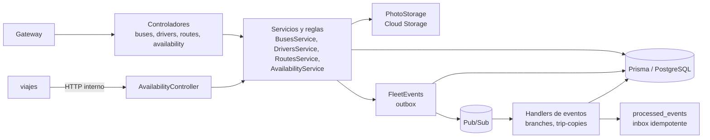
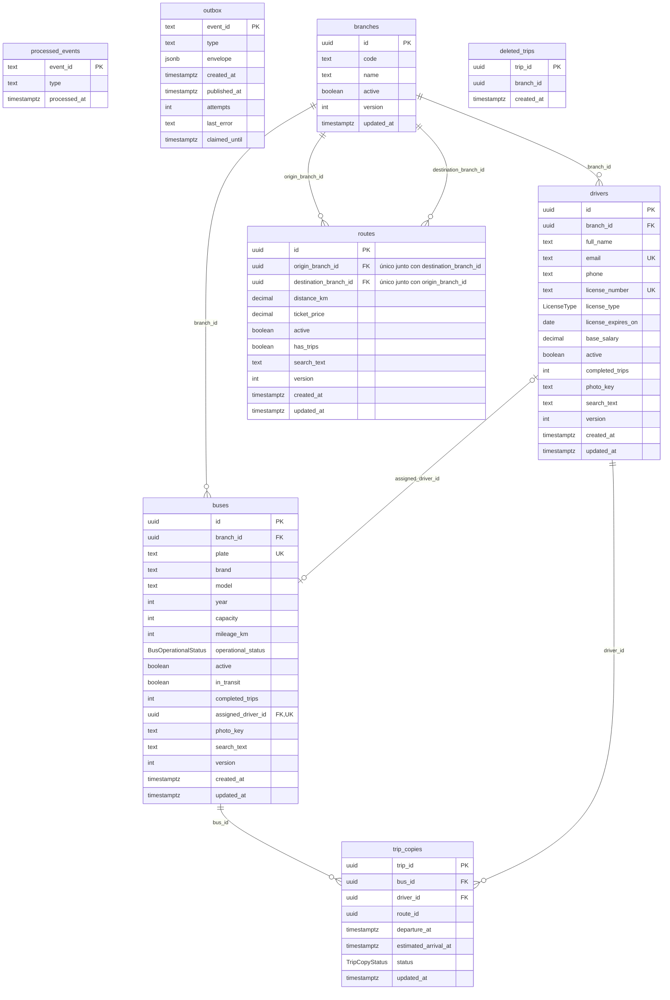
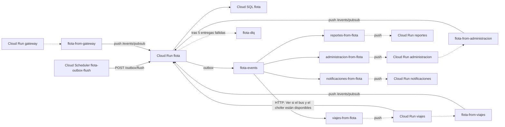

# Manual técnico · Flota

**Flota** es dueña de los buses, los choferes y las rutas de cada sucursal, y responde si un bus y un chofer pueden hacer un viaje.

## 1. Para qué sirve y qué reglas cumple

- **Buses.** Placa única, kilometraje que no baja, estado operativo, chofer de planta y foto (JPG, PNG o WebP de hasta 5 MB en Cloud Storage). Se desactivan sin borrar, y no mientras tengan viajes programados o en camino.
- **Choferes.** Licencia (número único, tipo y vencimiento) y salario base; su cuenta de acceso la crea `administracion` al recibir `DriverAdded` (también se publica `DriverUpdated`). Se desactivan sin borrar.
- **Rutas.** Una por par origen-destino (única), con distancia y precio; con viajes solo se desactivan. La sucursal destino debe estar activa.
- **Disponibilidad.** `GET /internal/availability` (solo entre servicios, con token de identidad) dice si un bus y un chofer pueden hacer un viaje: activos, de esa sucursal, fuera de taller, con licencia vigente y sin otro viaje en ese horario. `viajes` la consulta antes de programar.
- **Copias por eventos.** Guarda la copia de las sucursales (`BranchCreated`/`BranchUpdated`) y marca buses y choferes en camino o con un viaje más a partir de `TripDeparted`, `TripCompleted`, `TripScheduled` y `TripDeleted`.
- **Republicación.** Las rutas internas `POST /internal/{buses,drivers,routes}/republish` vuelven a publicar el estado actual (con la versión subida) para los servicios que empiezan a guardar copias.

## 2. Diagrama de componentes



## 3. Diagrama de tablas

Flota guarda buses, choferes, rutas y la copia de sucursales y de los viajes que le interesan, más las tablas del outbox y del inbox.

<!-- prettier-ignore-start -->
<!-- generado:tablas -->

<!-- /generado:tablas -->
<!-- prettier-ignore-end -->

## 4. Diagrama de despliegue

Cada servicio corre en su propio Cloud Run; los eventos viajan por Pub/Sub y las pocas llamadas síncronas por HTTP con el token de identidad de la cuenta de servicio.

<!-- prettier-ignore-start -->
<!-- generado:despliegue -->

<!-- /generado:despliegue -->
<!-- prettier-ignore-end -->

## 5. Eventos y manejo de fallos

Igual que el resto: el outbox se escribe en la misma transacción que el cambio y se publica por el job `flota-outbox-flush` (cada minuto) y al terminar cada petición; el inbox (`processed_events`) hace idempotente cada entrega; Pub/Sub reintenta y, tras 5 fallos, deja el mensaje en `flota-dlq`. Cuando `viajes` aún no tiene la copia de un bus recién creado contesta "Estamos terminando de registrar ese bus" y quien llama reintenta; `administracion` en ese caso contesta que no encuentra el bus.

<!-- prettier-ignore-start -->
<!-- generado:eventos -->
**Publica**

| Evento | Lo consumen |
| --- | --- |
| `BusAdded` | viajes, reportes, administracion |
| `BusUpdated` | viajes, reportes, administracion |
| `BusDeactivated` | viajes, reportes, administracion |
| `DriverAdded` | viajes, notificaciones, administracion, reportes |
| `DriverUpdated` | viajes, notificaciones, administracion, reportes |
| `RouteCreated` | viajes, reportes |
| `RouteUpdated` | viajes, reportes |
| `RouteDeleted` | viajes, reportes |

**Consume**

| Evento | Lo publica |
| --- | --- |
| `BranchCreated` | administracion |
| `BranchUpdated` | administracion |
| `TripScheduled` | viajes |
| `TripDeleted` | viajes |
| `TripDeparted` | viajes |
| `TripCompleted` | viajes |
| `ProbeSent` | gateway |
<!-- /generado:eventos -->
<!-- prettier-ignore-end -->

## 6. Endpoints

Todas las rutas pasan por el gateway con el prefijo `/api/flota` (aquí aparecen sin él). El detalle de cada cuerpo y respuesta está en el Swagger del gateway (`/docs`; en local, `http://localhost:4000/docs`) y en la colección [`postman/debus.postman_collection.json`](../../postman/debus.postman_collection.json).

<!-- prettier-ignore-start -->
<!-- generado:endpoints -->
| Método | Ruta | Qué hace | Roles |
| --- | --- | --- | --- |
| `GET` | `/buses` | Lista los buses | BRANCH_ADMIN |
| `POST` | `/buses` | Registra un bus | BRANCH_ADMIN |
| `GET` | `/buses/{id}` | Consulta un bus | BRANCH_ADMIN |
| `PATCH` | `/buses/{id}` | Cambia los datos de un bus | BRANCH_ADMIN |
| `POST` | `/buses/{id}/deactivate` | Desactiva un bus | BRANCH_ADMIN |
| `GET` | `/buses/{id}/photo` | Descarga la foto de un bus | BRANCH_ADMIN |
| `PUT` | `/buses/{id}/photo` | Sube la foto de un bus | BRANCH_ADMIN |
| `POST` | `/buses/{id}/reactivate` | Reactiva un bus | BRANCH_ADMIN |
| `GET` | `/dead-letters` | Lista los mensajes que fallaron y quedaron en la cola de errores | SYSTEM_ADMIN |
| `DELETE` | `/dead-letters/{messageId}` | Descarta un mensaje de la cola de errores | SYSTEM_ADMIN |
| `POST` | `/dead-letters/{messageId}/replay` | Vuelve a entregar un mensaje de la cola de errores | SYSTEM_ADMIN |
| `GET` | `/drivers` | Lista los choferes | BRANCH_ADMIN |
| `POST` | `/drivers` | Registra un chofer (su cuenta llega después, por evento) | BRANCH_ADMIN |
| `GET` | `/drivers/{id}` | Consulta un chofer | BRANCH_ADMIN |
| `PATCH` | `/drivers/{id}` | Cambia los datos de un chofer | BRANCH_ADMIN |
| `POST` | `/drivers/{id}/deactivate` | Desactiva un chofer | BRANCH_ADMIN |
| `GET` | `/drivers/{id}/photo` | Descarga la foto de un chofer | BRANCH_ADMIN |
| `PUT` | `/drivers/{id}/photo` | Sube la foto de un chofer | BRANCH_ADMIN |
| `POST` | `/drivers/{id}/reactivate` | Reactiva un chofer | BRANCH_ADMIN |
| `GET` | `/health` | Responde si el servicio está en línea | Cualquier sesión |
| `GET` | `/routes` | Lista las rutas | BRANCH_ADMIN |
| `POST` | `/routes` | Abre una ruta hacia otra sucursal | BRANCH_ADMIN |
| `PATCH` | `/routes/{id}` | Cambia la distancia, el precio o el estado de una ruta | BRANCH_ADMIN |
| `DELETE` | `/routes/{id}` | Elimina una ruta sin viajes | BRANCH_ADMIN |
<!-- /generado:endpoints -->
<!-- prettier-ignore-end -->

## 7. Variables de entorno

Las que recibe en Cloud Run salen de `cloudRunEnv` (`packages/contracts/src/cloud-run-env.ts`); en local las trae `services/flota/.env.example`.

| Variable               | Para qué sirve                                                                                        |
| ---------------------- | ----------------------------------------------------------------------------------------------------- |
| `PORT`                 | Puerto en el que escucha (el de su `.env.example` en local; Cloud Run lo asigna en producción).       |
| `SERVICE_NAME`         | Nombre del servicio; lo fija el despliegue y el código no lo lee.                                     |
| `DEBUS_ENV`            | `local` o `production`.                                                                               |
| `PUBSUB_PROJECT_ID`    | Proyecto de Pub/Sub (en local, el del emulador `debus-local`).                                        |
| `PUBSUB_AUDIENCE`      | Dirección del servicio: el token OIDC que Pub/Sub manda en cada entrega debe estar emitido para ella. |
| `PUBSUB_PUSH_SA`       | Cuenta de servicio que Pub/Sub usa para entregar; solo ella puede llamar a `POST /events/pubsub`.     |
| `PUBSUB_EMULATOR_HOST` | Solo en local: con él no se valida el token de Pub/Sub.                                               |
| `DATABASE_URL`         | Conexión a la base del servicio (en producción la arma el despliegue).                                |
| `DB_POOL_MAX`          | Conexiones máximas al pool (2 en Cloud Run, para no agotar Cloud SQL).                                |
| `MEDIA_BUCKET`         | Bucket de Cloud Storage de las fotos de buses y choferes.                                             |
| `MEDIA_EMULATOR_URL`   | Solo en local: dirección de `fake-gcs-server`, el bucket simulado.                                    |

## 8. Cómo correrlo y probarlo

```bash
pnpm install
pnpm local                                   # todo el stack: PostgreSQL, Pub/Sub, Mailpit, apps y migraciones
pnpm --filter @debus/flota test              # pruebas unitarias con cobertura (mínimo 85 %)
pnpm --filter @debus/flota test:integration  # contra PostgreSQL y el emulador de Pub/Sub (mínimo 65 %)
```

Las fotos se guardan en un bucket; en local, `fake-gcs-server` (`pnpm local` lo levanta).

Las pruebas que escriben datos usan correos `@debus.test` y el prefijo `Prueba ` y los borran al terminar; `pnpm test:clean` quita lo que haya quedado.
