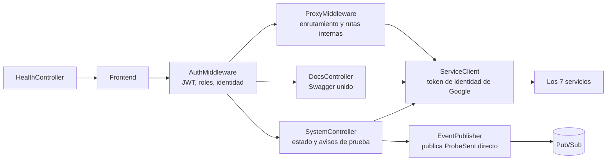
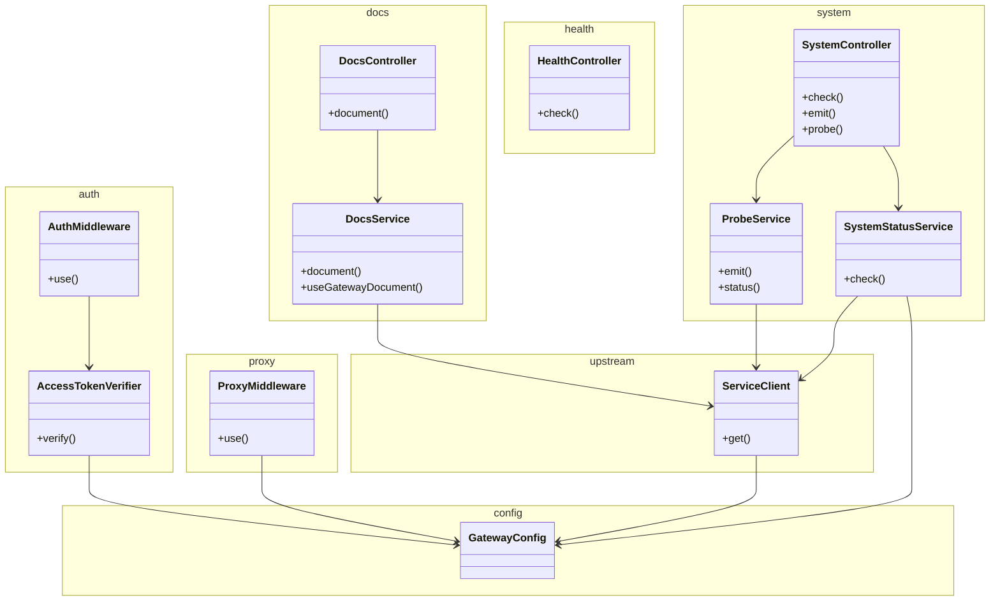
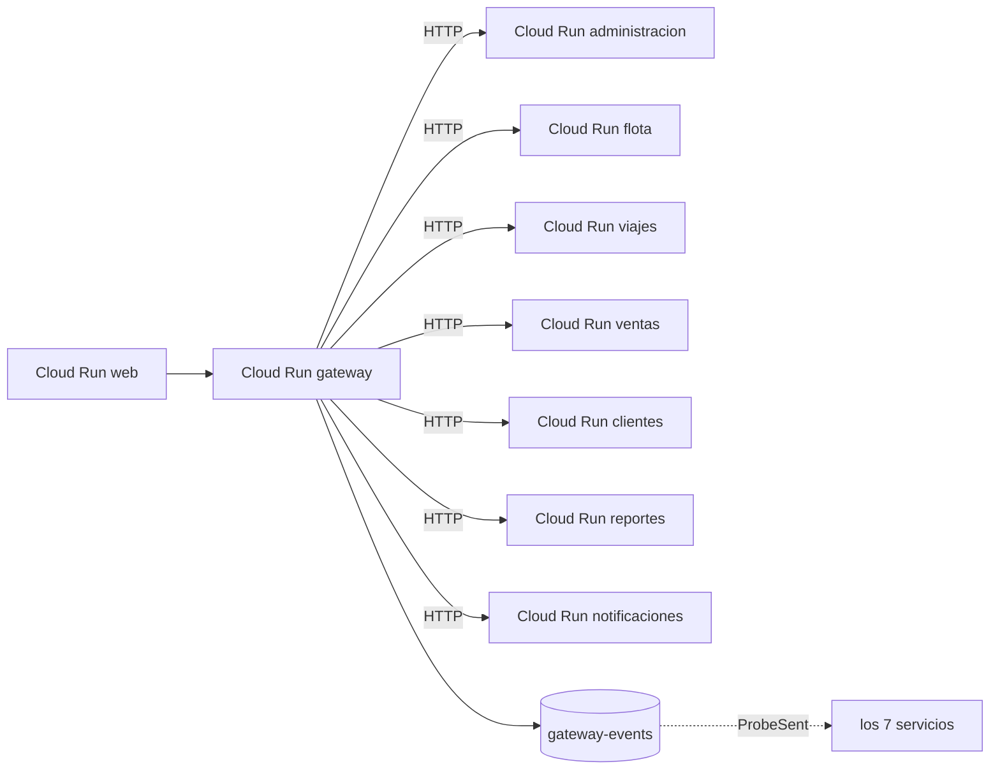

# Manual técnico · Gateway

En producción: [aplicación](https://web-169401355798.us-central1.run.app/) · [Swagger](https://gateway-avqapfieaa-uc.a.run.app/docs) (datos para los endpoints protegidos: pedirlos a un administrador).

**Repositorio:** [rrobertobt/sa-debus-gateway](https://github.com/rrobertobt/sa-debus-gateway) (monorepo: [JeffMenca/debus](https://github.com/JeffMenca/debus)).

El **gateway** es la única puerta pública del backend: el frontend solo habla con él. No tiene base de datos.

## 1. Para qué sirve y qué reglas cumple

- **Autenticación y roles.** Verifica el JWT de acceso (firma RS256, emisor `debus-administracion`, audiencia `debus`) y rechaza con 401 lo que no tenga sesión; las rutas de `/api/system` exigen el rol `SYSTEM_ADMIN`. Solo son públicas las rutas de acceso (`signup`, `login`, `refresh`, `logout`, `password`, `password/forgot`, `links/status`, `links/renew`) y `GET /api/administracion/branches/locations`, que alimenta el mapa de la página de inicio.
- **Identidad hacia los servicios.** Borra del pedido cualquier encabezado de identidad que mande el cliente y escribe los suyos (`x-user-id`, `x-user-role`, `x-branch-id`) a partir del token: los servicios confían solo en ellos.
- **Enrutamiento.** `/api/<servicio>/*` se reenvía al servicio correspondiente (`ventas`, `flota`, etc.) con el token de identidad de Google en producción; las rutas internas (`/internal/*`, `/events/*` y `/outbox/*`) nunca se publican. Canonicaliza la ruta (mayúsculas, barras repetidas, barra final) y una ruta con `%`, `\` o `..` nunca se trata como pública, para que una variante no salte la regla de acceso.
- **Swagger unido.** `/docs-json` junta los documentos de los siete servicios (con las etiquetas `<servicio> · <etiqueta>`) y `/docs` lo muestra ([producción](https://gateway-avqapfieaa-uc.a.run.app/docs)); un servicio caído no rompe la documentación de los demás. En producción piden usuario y contraseña (Basic Auth, usuario `debus`, contraseña `DOCS_PASSWORD`); en local quedan abiertos.
- **Diagnóstico.** `GET /api/system/status` mide a los 7 servicios (el gateway se reporta arriba porque es quien responde) y `POST /api/system/probes` publica el evento de prueba `ProbeSent`, que llega por Pub/Sub a los siete servicios; `GET /api/system/probes/:id` dice cuáles lo recibieron.

## 2. Diagrama de componentes



## 2.1 Diagrama de clases

Controladores, servicios y sus dependencias, agrupados por carpeta. Se genera del código con `pnpm run docs`.

<!-- prettier-ignore-start -->
<!-- generado:clases -->

<!-- /generado:clases -->
<!-- prettier-ignore-end -->

## 3. Diagrama de tablas

El gateway no tiene base de datos: no guarda nada, solo reenvía y verifica.

<!-- prettier-ignore-start -->
<!-- generado:tablas -->
El gateway no tiene base de datos.
<!-- /generado:tablas -->
<!-- prettier-ignore-end -->

## 4. Diagrama de despliegue

Cada servicio corre en su propio Cloud Run; los eventos viajan por Pub/Sub y las pocas llamadas síncronas por HTTP con el token de identidad de la cuenta de servicio.

<!-- prettier-ignore-start -->
<!-- generado:despliegue -->

<!-- /generado:despliegue -->
<!-- prettier-ignore-end -->

## 5. Eventos y manejo de fallos

El gateway solo **publica** `ProbeSent` (diagnóstico) y no consume eventos. Como no tiene base de datos no tiene outbox: `ProbeService` lo publica directo en Pub/Sub con `EventPublisher`, sin reintento propio, y si la publicación falla el pedido responde con error y el aviso no se envía. Si el servicio de destino no responde, el gateway contesta 502 con el mensaje "El servicio no respondió. Intenta de nuevo en unos segundos." y un `correlationId` que sirve para seguir el pedido en los logs de los demás. Quien sí usa outbox, inbox y cola de errores son los servicios con base (ver sus manuales).

`GET /api/system/status` (la tarjeta "Servicios" de `/admin/estado`) pregunta `/health` a cada servicio y, además de si responde, junta los **circuitos** que cada uno informa: el estado de su conexión con los servicios que llama (por ejemplo, "Conexión con Clientes · En pausa hasta 10:32:05"). Si un servicio no los informa (una revisión anterior) o su respuesta no coincide con el contrato, se omiten y el servicio sigue marcado como en línea.

<!-- prettier-ignore-start -->
<!-- generado:eventos -->
**Publica**

| Evento | Lo consumen |
| --- | --- |
| `ProbeSent` | administracion, flota, viajes, ventas, clientes, reportes, notificaciones |

**Consume**

No consume eventos.
<!-- /generado:eventos -->
<!-- prettier-ignore-end -->

## 6. Endpoints

Estas son las rutas propias del gateway; las de cada servicio están en su manual, con el prefijo `/api/<servicio>`. El detalle de cada cuerpo y respuesta está en el Swagger del gateway (`/docs`; en local, `http://localhost:4000/docs`) y en la colección [`postman/debus.postman_collection.json`](../../postman/debus.postman_collection.json).

<!-- prettier-ignore-start -->
<!-- generado:endpoints -->
| Método | Ruta | Qué hace | Roles |
| --- | --- | --- | --- |
| `POST` | `/api/system/probes` | Envía un aviso de prueba por Pub/Sub a los siete servicios | SYSTEM_ADMIN |
| `GET` | `/api/system/probes/{probeId}` | Dice qué servicios recibieron un aviso de prueba | SYSTEM_ADMIN |
| `GET` | `/api/system/status` | Mide si los siete servicios responden | SYSTEM_ADMIN |
| `GET` | `/health` | Responde si el servicio está en línea | Público |
<!-- /generado:endpoints -->
<!-- prettier-ignore-end -->

## 7. Variables de entorno

Las que recibe en Cloud Run salen de `cloudRunEnv` (`packages/contracts/src/cloud-run-env.ts`); en local las trae `services/gateway/.env.example`.

| Variable                 | Para qué sirve                                                                                   |
| ------------------------ | ------------------------------------------------------------------------------------------------ |
| `PORT`                   | Puerto en el que escucha (el de su `.env.example` en local; Cloud Run lo asigna en producción).  |
| `SERVICE_NAME`           | Nombre del servicio; lo fija el despliegue y el código no lo lee.                                |
| `DEBUS_ENV`              | `local` o `production`.                                                                          |
| `PUBSUB_PROJECT_ID`      | Proyecto de Pub/Sub (en local, el del emulador `debus-local`).                                   |
| `SERVICE_AUTH`           | `google` en producción: cada llamada a un servicio lleva un token de identidad; `none` en local. |
| `CORS_ORIGINS`           | Direcciones del frontend que pueden llamar al gateway.                                           |
| `JWT_PUBLIC_KEY`         | Clave pública con la que se verifican los tokens de acceso.                                      |
| `SERVICE_URL_<SERVICIO>` | Dirección de cada uno de los siete servicios (`SERVICE_URL_FLOTA`, etc.).                        |
| `PUBSUB_EMULATOR_HOST`   | Solo en local.                                                                                   |

## 8. Cómo correrlo y probarlo

```bash
pnpm install
pnpm local                                   # todo el stack: PostgreSQL, Pub/Sub, Mailpit, apps y migraciones
pnpm --filter @debus/gateway test              # pruebas unitarias con cobertura (mínimo 85 %)
pnpm --filter @debus/gateway test:integration  # el gateway real con servicios de destino simulados, sin base de datos (mínimo 65 %)
```

El gateway local escucha en `http://localhost:4000`; el Swagger unido está en `/docs`. En producción: <https://gateway-avqapfieaa-uc.a.run.app/docs>.

Las pruebas que escriben datos usan correos `@debus.test` y el prefijo `Prueba ` y los borran al terminar; `pnpm test:clean` quita lo que haya quedado.
