# Manual de usuario · Clientes

Con **debus** compras boletos de bus, eliges tu asiento, recargas tu cartera y alquilas un bus para tu grupo.

Entra desde tu navegador, en la computadora o en el celular: <https://web-169401355798.us-central1.run.app/>

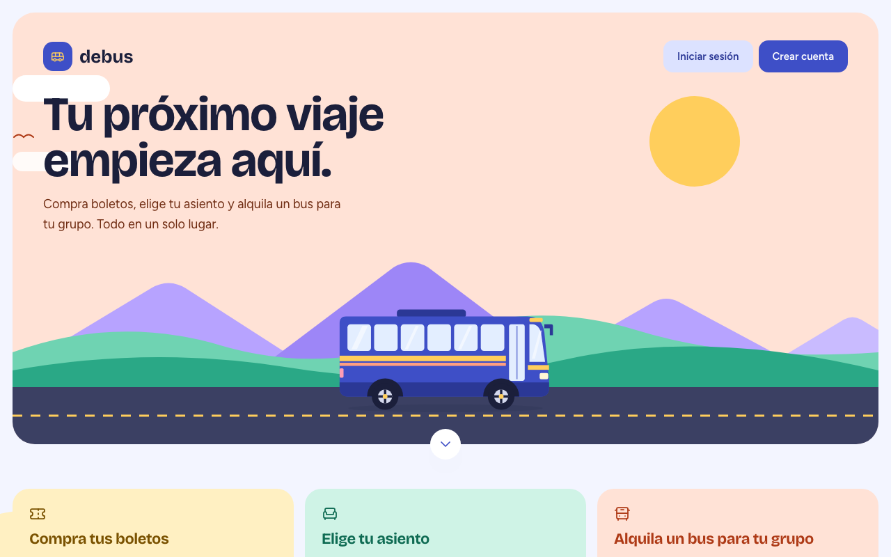

En el celular se ve igual, acomodado a tu pantalla:

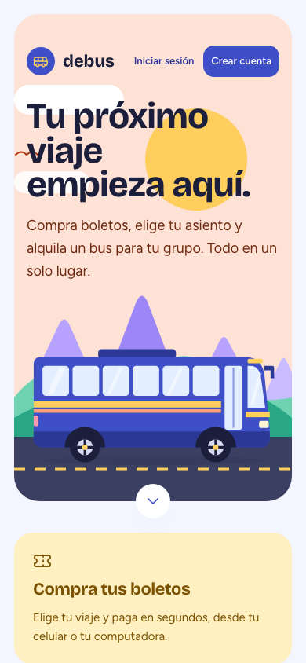

## Crear y activar tu cuenta

Necesitas una cuenta para comprar en línea y para pedir un alquiler.

1. Toca **Crear cuenta**.
2. Escribe tu nombre completo, tu DPI, tu teléfono y tu correo. El NIT y la dirección son opcionales.
3. Toca **Crear cuenta**.
4. Abre el correo que te enviamos y sigue el enlace para elegir tu contraseña. Usa al menos 8 caracteres.

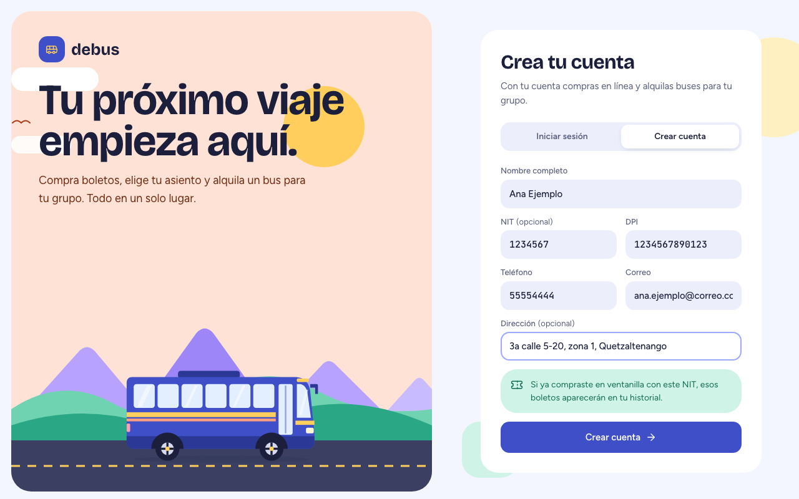

Los campos solo aceptan lo que les sirve: en el teléfono y el DPI no se pueden escribir letras, y si pegas un número con guiones se guardan solo los dígitos.

**Si algo sale mal**

| Mensaje o situación                                         | Qué hacer                                                                          |
| ----------------------------------------------------------- | ---------------------------------------------------------------------------------- |
| "El DPI tiene 13 dígitos." o "El teléfono tiene 8 dígitos." | Revisa que el número esté completo.                                                |
| "Revisa el NIT: solo números y, al final, un número o K."   | Corrige el NIT o déjalo vacío.                                                     |
| El enlace ya no sirve                                       | Dura 48 horas y se usa una sola vez. Pide otro desde **¿Olvidaste tu contraseña?** |

Si ya compraste en ventanilla con tu NIT, esos boletos aparecerán en tu historial al escribirlo en tu cuenta.

## Entrar y recuperar tu contraseña

1. Toca **Iniciar sesión**.
2. Escribe tu correo y tu contraseña.
3. Toca **Ingresar**.

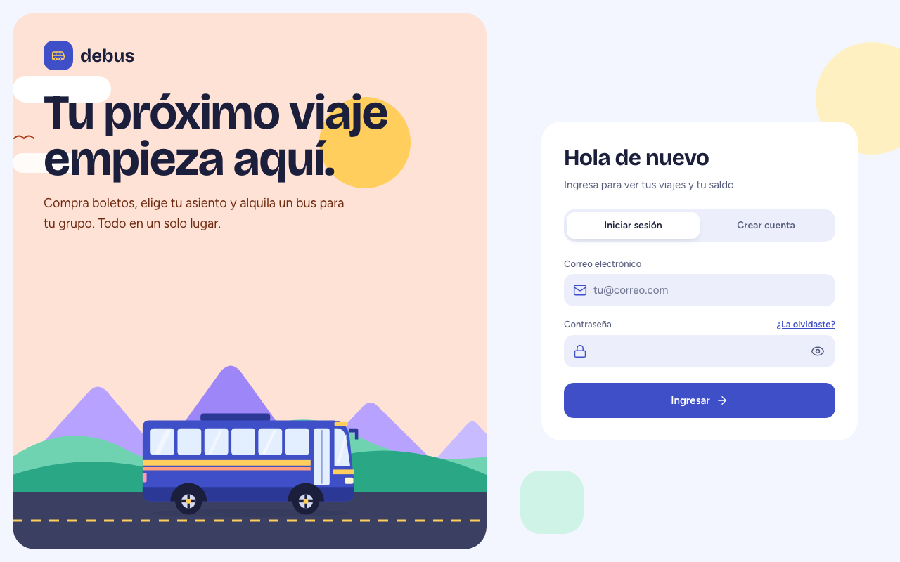

Si no recuerdas tu contraseña, toca **¿La olvidaste?**, escribe tu correo y sigue el enlace que te enviamos. Ese enlace dura 1 hora.

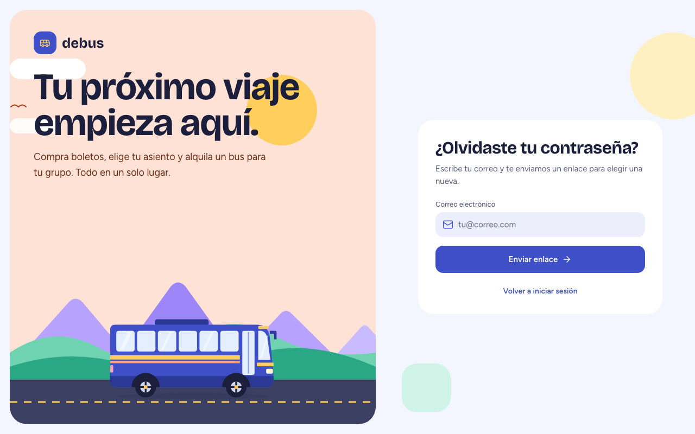

**Si algo sale mal**

| Mensaje                                                                                        | Qué hacer                                                   |
| ---------------------------------------------------------------------------------------------- | ----------------------------------------------------------- |
| "El correo o la contraseña no coinciden."                                                      | Revisa lo que escribiste. Después de 5 intentos se bloquea. |
| "Por seguridad bloqueamos tu cuenta 15 minutos. Intenta más tarde o restablece tu contraseña." | Espera 15 minutos o recupera tu contraseña.                 |

## Recargar tu cartera

Las compras en línea se pagan con el saldo de tu cartera.

1. Entra a **Mi cuenta**.
2. En **Recargar saldo**, toca un monto sugerido o escribe otro en **Monto**.
3. Revisa la **Fecha de recarga**: trae el día de hoy y puedes cambiarla si pagaste otro día.
4. Toca **Recargar**.

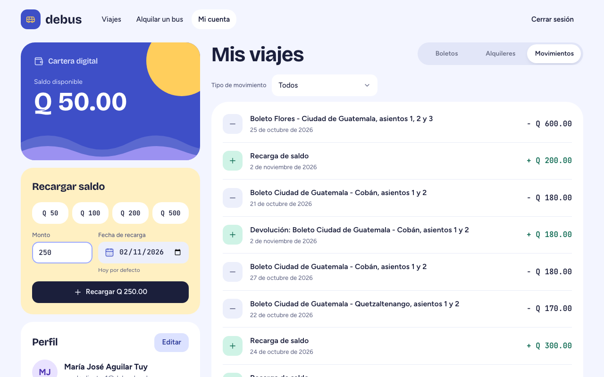

Puedes recargar hasta Q 100,000 cada vez, con dos decimales como máximo. Te enviamos un correo con cada recarga.

Para ver todo lo que entra y sale de tu cartera, abre la pestaña **Movimientos**:

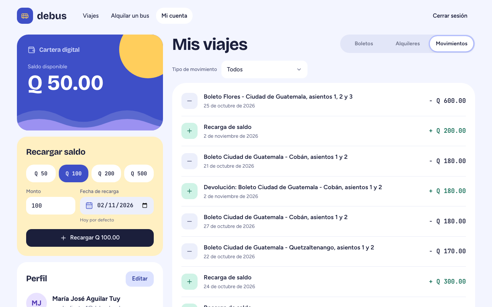

**Si algo sale mal:** "Escribe un monto mayor a Q 0, con hasta dos decimales y hasta Q 100,000." quiere decir que el monto no es válido. Corrígelo y vuelve a tocar **Recargar**.

## Buscar un viaje

1. Entra a **Viajes**.
2. Elige **Origen**, **Destino** y **Fecha de salida**. La fecha trae el día de hoy.
3. Escribe cuántos **Pasajeros** son, de 1 a 10.
4. Toca **Buscar viajes**.

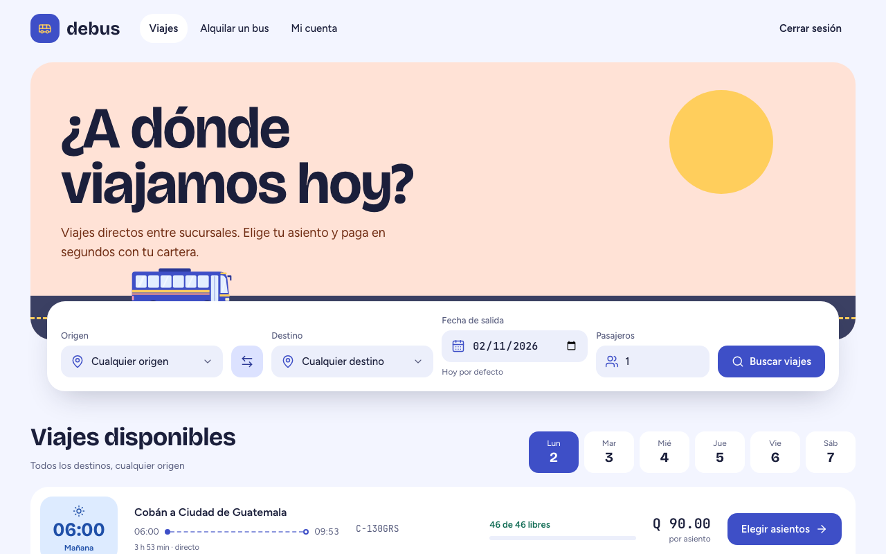

También puedes cambiar de día con los botones que están sobre la lista. Cada viaje muestra su hora, los asientos libres y el precio por asiento.

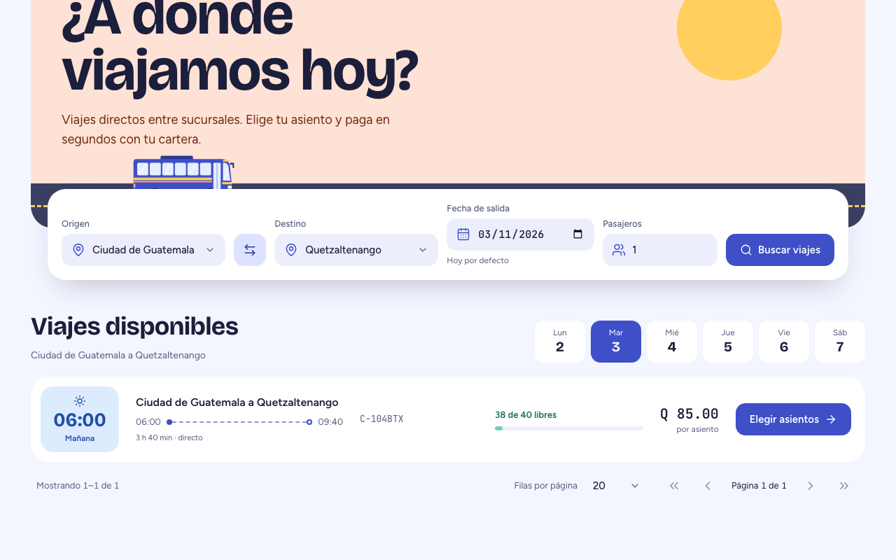

## Elegir tus asientos y pagar

1. En el viaje que quieres, toca **Elegir asientos**.
2. Toca los asientos libres en el mapa del bus. Puedes elegir hasta 10.
3. Revisa el total y tu saldo después del pago.
4. Revisa la **Fecha de pago**.
5. Toca **Pagar**.

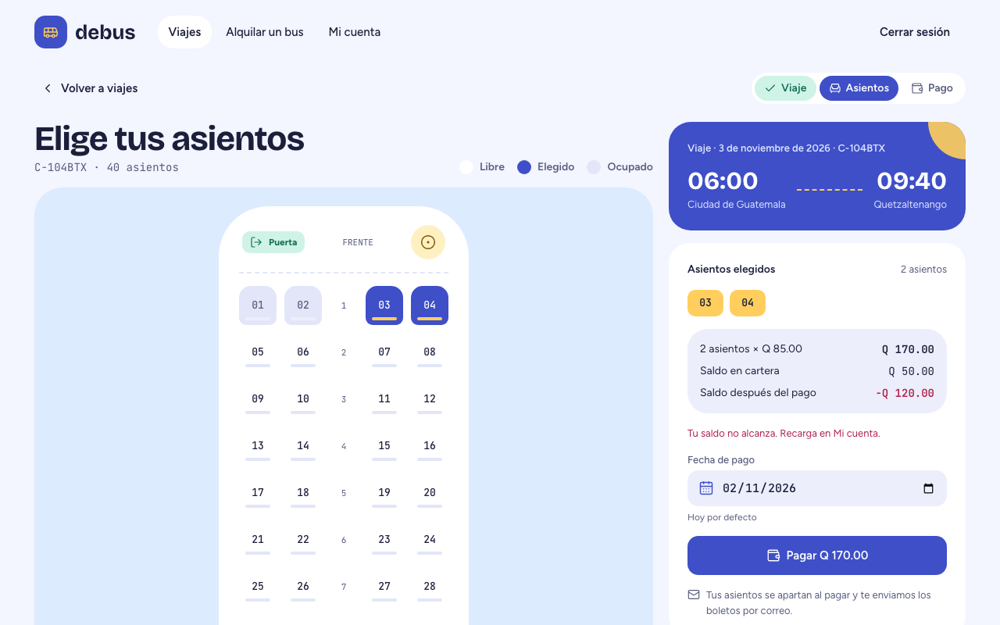

En el celular, el resumen del pago aparece debajo del mapa:

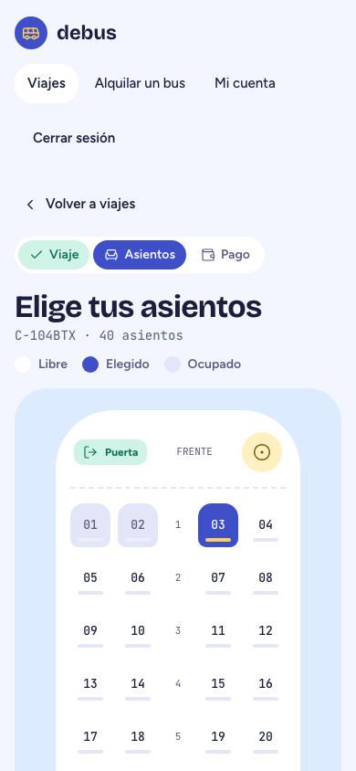

Tus asientos se apartan al pagar, no antes, y te enviamos los boletos por correo.

**Si algo sale mal**

| Mensaje o situación                          | Qué hacer                                                                |
| -------------------------------------------- | ------------------------------------------------------------------------ |
| "Tu saldo no alcanza. Recarga en Mi cuenta." | Recarga tu cartera y vuelve a la compra.                                 |
| Te avisa que un asiento ya no está libre     | Alguien lo compró antes. Elige otro asiento. No se te cobró ese asiento. |
| "Pago en confirmación"                       | Lee la sección siguiente.                                                |

## Ver tus boletos

Tus boletos están en **Mi cuenta**, en la pestaña **Boletos**. Arriba aparece tu próximo viaje y abajo todo tu historial, con los boletos en línea y los de ventanilla comprados con tu NIT.

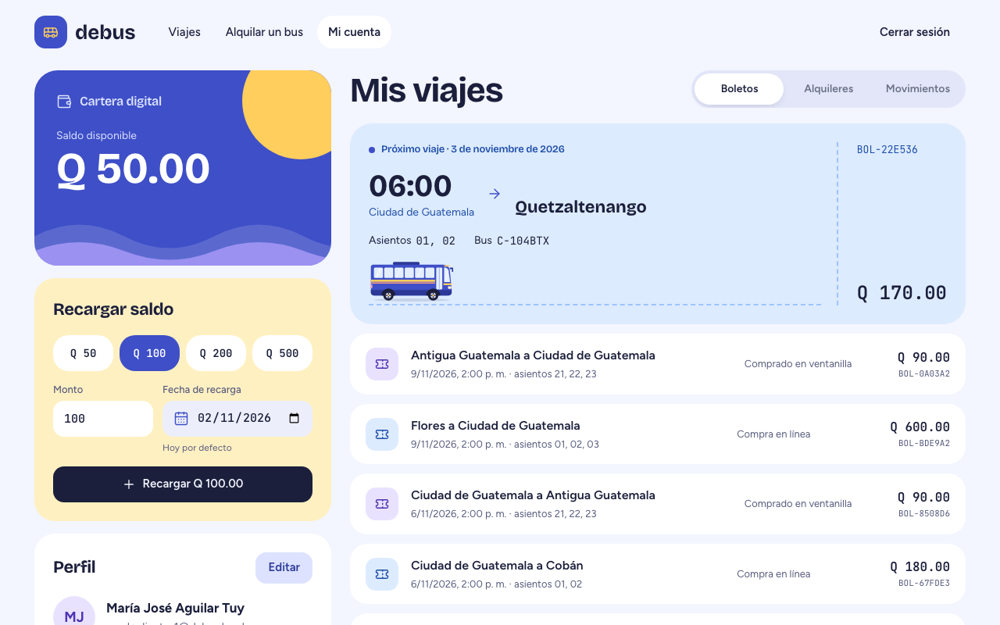

**¿Qué significa "Pago en confirmación"?** Tu pago se está terminando de comprobar. Espera un momento: el boleto pasa solo a pagado. No hace falta que pagues otra vez; si la compra no se completa, el dinero vuelve a tu cartera.

## Si cancelan tu viaje

Si la sucursal cancela un viaje que compraste, te devolvemos el dinero a tu cartera. Lo verás en **Movimientos** como **Devolución**, y también te avisamos por correo. No tienes que pedirlo.

## Pedir un alquiler

Sirve para alquilar un bus completo con chofer para tu grupo.

1. Entra a **Alquilar un bus**.
2. Elige la **Sucursal que te atiende**.
3. Escribe de dónde salen (**Salen de**) y adónde van (**Van a**).
4. Elige el día y la hora de salida. Si es ida y vuelta, escribe también el regreso.
5. Escribe los **Pasajeros** y la **Distancia aproximada (km)**. Si no la sabes, pon un aproximado: la sucursal la corrige.
6. Toca **Pedir cotización**.

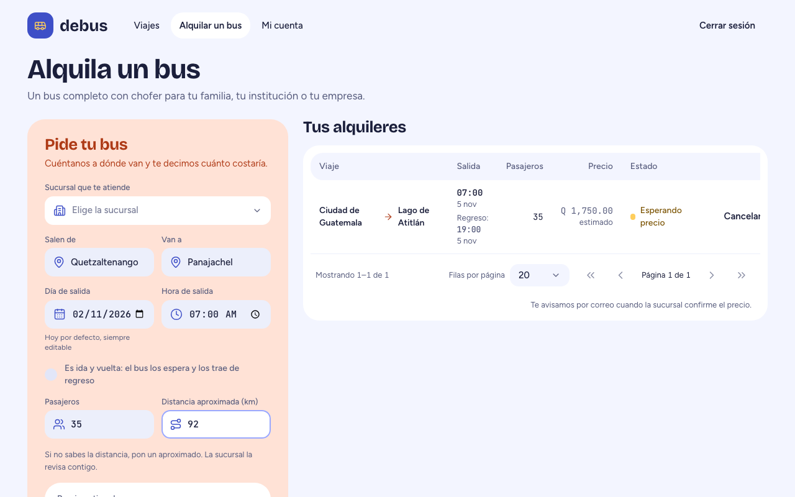

Tu alquiler pasa por estos estados, que ves en la misma pantalla:

| Estado                    | Qué significa                                                      |
| ------------------------- | ------------------------------------------------------------------ |
| Esperando precio          | La sucursal está revisando tu pedido.                              |
| Precio listo, falta pagar | Ya tiene precio. Págalo con tu cartera desde la misma pantalla.    |
| Pagado                    | Ya está. La sucursal le asigna bus y chofer.                       |
| Cancelado                 | Se canceló. Si ya lo habías pagado, el dinero vuelve a tu cartera. |

## Editar tu perfil

En **Mi cuenta**, en la tarjeta **Perfil**, toca **Editar**. Puedes cambiar tu NIT, tu DPI, tu teléfono y tu dirección.

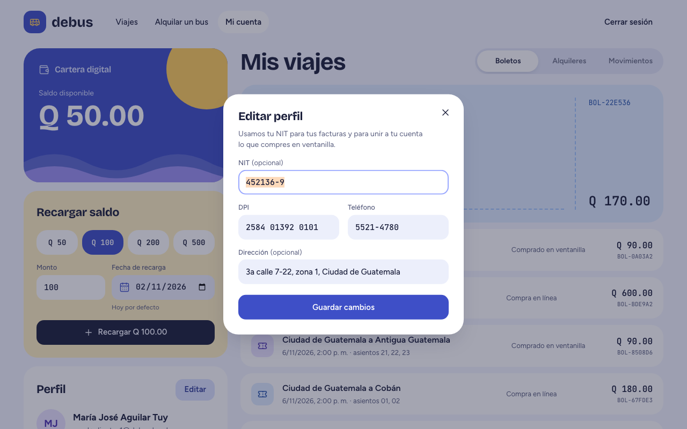

Al escribir tu NIT aparecen en tu historial los boletos que compraste con él en ventanilla. Si el NIT ya lo usa otra cuenta, la pantalla te lo avisa junto al campo.

## Preguntas frecuentes

**¿Puedo comprar sin saldo?** No en línea. Recarga primero o compra en ventanilla, donde se paga en efectivo.

**No me llegó el correo.** Revisa la carpeta de correo no deseado. Se envían hasta 3 correos de cuenta por hora, así que espera un poco antes de pedir otro.

**¿Dónde pido ayuda con mi cuenta?** Con un administrador de debus.
