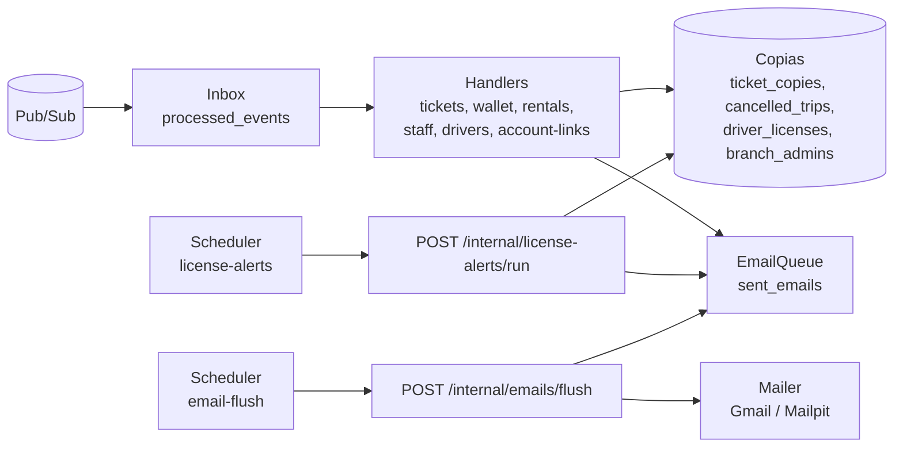
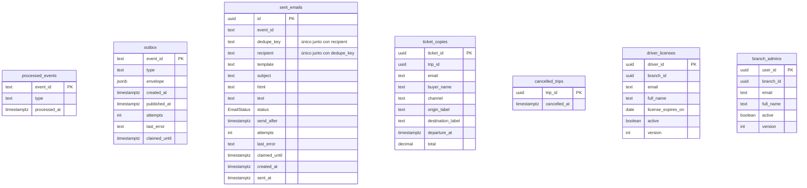
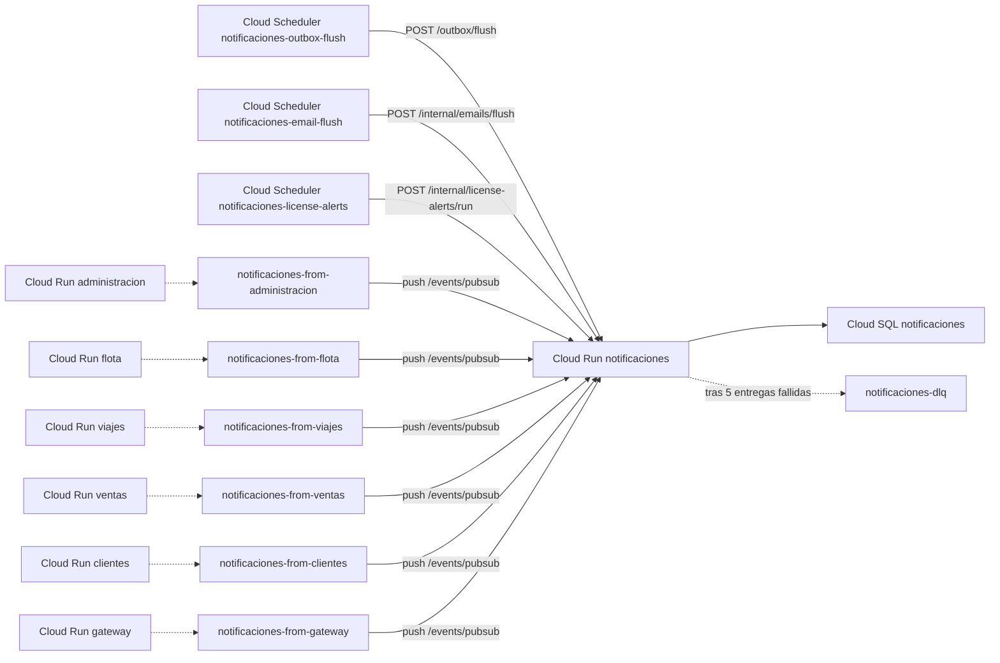

# Manual técnico · Notificaciones

**Notificaciones** manda todos los correos de debus: los de las cuentas, los de los clientes (boleto, viaje cancelado, devolución, recarga y alquiler) y las alertas de licencia de los choferes. No tiene pantallas ni rutas públicas: todo le llega por eventos y guarda copias locales de lo que necesita.

## 1. Para qué sirve y qué reglas cumple

| Correo                                    | Lo dispara                                     | A quién va                                                                                |
| ----------------------------------------- | ---------------------------------------------- | ----------------------------------------------------------------------------------------- |
| Cuenta (invitación, registro, contraseña) | `AccountLinkSent`                              | La cuenta. Sale en el momento y no se guarda su contenido, porque lleva un enlace secreto |
| Boleto comprado                           | `TicketSold`                                   | El correo de la compra (en línea siempre; en ventanilla, si se capturó)                   |
| Viaje cancelado                           | `TripDeleted`                                  | Cada boleto con correo de ese viaje, tomado de la copia `ticket_copies`                   |
| Devolución a la cartera                   | `WalletCredited` (`REFUND`)                    | El dueño de la cartera, cuando el dinero ya está acreditado                               |
| Recarga de saldo                          | `WalletCredited` (`TOP_UP`)                    | El dueño de la cartera                                                                    |
| Cotización de alquiler lista              | `RentalConfirmed`                              | El cliente que pidió el alquiler en línea, cuando la sucursal fijó el precio              |
| Alquiler pagado                           | `RentalPaid` con `email`                       | El correo del alquiler, si lo tiene                                                       |
| Licencia por vencer (30, 15 y 3 días)     | `DriverAdded`, `DriverUpdated` y el job diario | El chofer y los admins activos de su sucursal                                             |

- **Una sola vez.** Cada correo tiene una clave de negocio (`ticket-sold:<boleto>`, `wallet-credited:<movimiento>`, `license:<chofer>:<vencimiento>:<umbral>`…). Con el destinatario es única en `sent_emails`, así que un evento repetido o republicado con otro `eventId` no repite el correo.
- **Fechas en hora de Guatemala** y montos en quetzales, con el diseño común de `renderEmailLayout`.
- **Copias por eventos.**
  - `ticket_copies` guarda los boletos con correo hasta un día después de la salida.
  - `cancelled_trips` guarda los viajes eliminados por 30 días: un `TicketSold` que llega tarde recibe el aviso de cancelación, no el de compra.
  - `driver_licenses` (de `DriverAdded`/`DriverUpdated`) y `branch_admins` (de `UserRegistered`/`UserUpdated`) solo aceptan una versión mayor.

### Cola de correos

Los handlers no mandan el correo: lo dejan en `sent_emails` como `PENDING`, en la misma transacción del inbox. El job `notificaciones-email-flush` (cada minuto; en local, cada 30 s) los manda:

1. Toma hasta 20 filas vencidas con `FOR UPDATE SKIP LOCKED` y un lease de 15 minutos. Dos envíos a la vez nunca toman la misma fila, y la de un proceso que murió vuelve sola al vencer el lease.
2. Manda cada una por SMTP (plazo de 25 s).
   - Si sale, queda `SENT`.
   - Si falla, sube `attempts`, guarda el error y se reintenta tras 1, 2, 4… minutos (máximo 6 h). Tras 8 intentos queda `FAILED` con un error en el log.
3. Un correo `CANCELLED` (una alerta de licencia que dejó de valer) no se manda nunca.

Así un `TripDeleted` con muchos compradores no depende de que todos los envíos quepan en una transacción, y un error de SMTP no repite los correos que ya salieron.

### Saga y circuit breaker

- **Circuit breaker:** no aplica. Notificaciones no hace llamadas HTTP a otros servicios; el SMTP lo acota el plazo de envío y los reintentos de la cola.
- **Saga:** un correo no cambia el estado de otro servicio ni tiene nada que compensar. Es el último paso, **reintentable**, de sagas que ya existen:
  - En la saga coreografiada del viaje eliminado (manual de [ventas](../ventas/README.md)) es el paso **S4**: avisa a los compradores al recibir `TripDeleted` y confirma la devolución con `WalletCredited`.
  - En la saga de compra cuelga del **pivote** (`TicketSold`).
  - Idempotencia: inbox por `eventId` y la clave única `(dedupe_key, recipient)`. Estado persistido: `sent_emails`. Recuperación: el flush con reintentos y lease.

### Alertas de licencia

- Las alertas no se guardan por adelantado: la copia del chofer es el calendario. Cada día a las 08:00 (hora de Guatemala) el job `notificaciones-license-alerts` revisa los choferes activos cuya licencia vence en 30 días o menos y encola el **umbral más cercano ya alcanzado**. Con 10 días por delante corresponde el de 15; con 2, el de 3.
- Si el job no corre un día, se pone al día al siguiente, y un chofer nuevo nunca recibe tres avisos juntos.
- `DriverAdded`/`DriverUpdated` encolan de inmediato lo que ya corresponda.
  - Si cambió el vencimiento, el correo o la sucursal, o el chofer se desactivó, cancelan lo pendiente.
  - La clave lleva la fecha de vencimiento, así que una fecha nueva tiene sus propias alertas.
  - Un republish con los mismos datos y la versión subida no cancela ni repite nada.
- El aviso va al chofer y a cada admin activo de su sucursal. Un admin agregado después recibe la alerta vigente en la siguiente corrida diaria.

## 2. Diagrama de componentes



## 3. Diagrama de tablas

La cola de correos, las copias que llegan por eventos y las tablas del outbox y del inbox.

<!-- prettier-ignore-start -->
<!-- generado:tablas -->

<!-- /generado:tablas -->
<!-- prettier-ignore-end -->

## 4. Diagrama de despliegue

<!-- prettier-ignore-start -->
<!-- generado:despliegue -->

<!-- /generado:despliegue -->
<!-- prettier-ignore-end -->

## 5. Eventos y manejo de fallos

Consume eventos con el inbox idempotente (`processed_events`); Pub/Sub reintenta y, tras 5 fallos, deja el mensaje en `notificaciones-dlq`. No publica eventos de negocio.

<!-- prettier-ignore-start -->
<!-- generado:eventos -->
**Publica**

No publica eventos.

**Consume**

| Evento | Lo publica |
| --- | --- |
| `UserRegistered` | administracion |
| `AccountLinkSent` | administracion |
| `DriverAdded` | flota |
| `DriverUpdated` | flota |
| `TripDeleted` | viajes |
| `TicketSold` | ventas |
| `RentalPaid` | clientes |
| `WalletCredited` | clientes |
| `UserUpdated` | administracion |
| `RentalConfirmed` | clientes |
| `ProbeSent` | gateway |
<!-- /generado:eventos -->
<!-- prettier-ignore-end -->

## 6. Endpoints

En el gateway (prefijo `/api/notificaciones`) solo tiene las rutas comunes de salud y de la cola de errores, en la tabla de abajo. Sus rutas internas las llama Cloud Scheduler con el token OIDC de `pubsub-invoker` (sin el emulador se rechaza cualquier otra identidad):

- `POST /internal/emails/flush`: manda los correos pendientes y responde `{ sent, failed }`.
- `POST /internal/license-alerts/run`: encola las alertas del día, poda las copias viejas y responde `{ drivers, queued }`.

<!-- prettier-ignore-start -->
<!-- generado:endpoints -->
| Método | Ruta | Qué hace | Roles |
| --- | --- | --- | --- |
| `GET` | `/dead-letters` | Lista los mensajes que fallaron y quedaron en la cola de errores | SYSTEM_ADMIN |
| `DELETE` | `/dead-letters/{messageId}` | Descarta un mensaje de la cola de errores | SYSTEM_ADMIN |
| `POST` | `/dead-letters/{messageId}/replay` | Vuelve a entregar un mensaje de la cola de errores | SYSTEM_ADMIN |
| `GET` | `/health` | Responde si el servicio está en línea | Cualquier sesión |
<!-- /generado:endpoints -->
<!-- prettier-ignore-end -->

## 7. Variables de entorno

Las que recibe en Cloud Run salen de `cloudRunEnv` (`packages/contracts/src/cloud-run-env.ts`); en local las trae `services/notificaciones/.env.example`.

| Variable                     | Para qué sirve                                                                                      |
| ---------------------------- | --------------------------------------------------------------------------------------------------- |
| `PORT`                       | Puerto en el que escucha (el de su `.env.example` en local; Cloud Run lo asigna en producción).     |
| `SERVICE_NAME`               | Nombre del servicio; lo fija el despliegue y el código no lo lee.                                   |
| `DEBUS_ENV`                  | `local` (Mailpit) o `production` (Gmail).                                                           |
| `PUBSUB_PROJECT_ID`          | Proyecto de Pub/Sub (en local, el del emulador `debus-local`).                                      |
| `PUBSUB_AUDIENCE`            | Dirección del servicio: el token OIDC de Pub/Sub y de Cloud Scheduler debe estar emitido para ella. |
| `PUBSUB_PUSH_SA`             | Cuenta de servicio que entrega los eventos y llama a los jobs.                                      |
| `PUBSUB_EMULATOR_HOST`       | Solo en local: con él no se valida el token.                                                        |
| `DATABASE_URL`               | Conexión a la base del servicio (en producción la arma el despliegue).                              |
| `DB_POOL_MAX`                | Conexiones máximas al pool.                                                                         |
| `SMTP_HOST`, `SMTP_PORT`     | Solo en local: Mailpit (`localhost:1025`).                                                          |
| `SMTP_USER`, `SMTP_PASSWORD` | En producción: la cuenta de Gmail que envía (secretos de Secret Manager).                           |
| `MAILPIT_URL`                | Solo para las pruebas: la bandeja de Mailpit (`http://localhost:8025`).                             |

## 8. Cómo correrlo y probarlo

```bash
pnpm install
pnpm local                                            # todo el stack; los correos llegan a Mailpit (http://localhost:8025)
pnpm --filter @debus/notificaciones test              # pruebas unitarias con cobertura (mínimo 85 %)
pnpm --filter @debus/notificaciones test:integration  # contra PostgreSQL y Mailpit (mínimo 65 %)
curl -X POST http://localhost:4007/internal/license-alerts/run   # las alertas del día, a mano
```

- Las pruebas de la cola y de las alertas corren en un esquema propio (`test_run_*`), así nunca toman ni mandan los correos pendientes del stack local.
- Las que escriben datos usan correos `@debus.test`; `pnpm test:clean` borra las filas de prueba de `sent_emails` y de las copias.
- Después de desplegar por primera vez las copias de choferes y admins, corre el workflow `republish` con `administracion/users` y `flota/drivers` para llenarlas.
