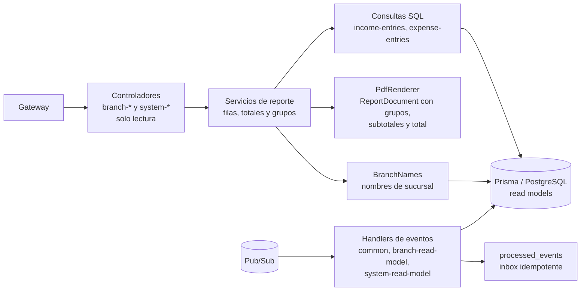
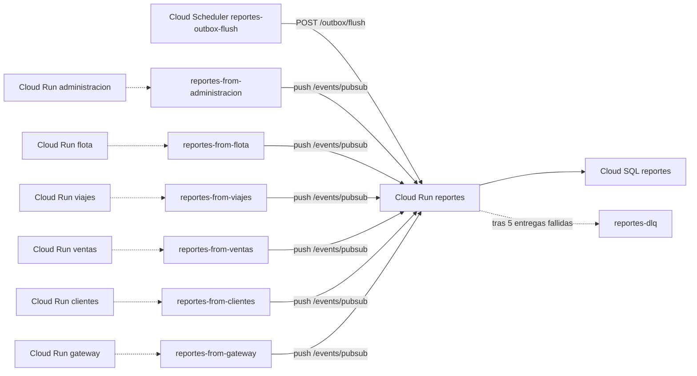

# Manual técnico · Reportes

En producción: [aplicación](https://web-169401355798.us-central1.run.app/) · [Swagger](https://gateway-avqapfieaa-uc.a.run.app/docs) (datos para los endpoints protegidos: pedirlos a un administrador).

**Repositorio:** [rrobertobt/sa-debus-reportes](https://github.com/rrobertobt/sa-debus-reportes) (monorepo: [JeffMenca/debus](https://github.com/JeffMenca/debus)).

**Reportes** responde los 12 reportes del enunciado (6 de sucursal y 6 del administrador del sistema) y los exporta a PDF; además, para el administrador del sistema, la vista **Arquitectura**, que no es uno de los 12. No escribe en ningún otro servicio: guarda sus propias copias de lo que le interesa, llenadas por eventos, y las consulta con SQL.

## 1. Para qué sirve y qué reglas cumple

| Quién los ve      | Reporte                        | Ruta del web                             | Endpoints (con `/pdf` para exportar)  |
| ----------------- | ------------------------------ | ---------------------------------------- | ------------------------------------- |
| Admin de sucursal | Listado de buses               | `/sucursal/reportes/buses`               | `GET /reports/branch-buses`           |
| Admin de sucursal | Listado de choferes            | `/sucursal/reportes/choferes`            | `GET /reports/branch-drivers`         |
| Admin de sucursal | Depreciación por bus           | `/sucursal/reportes/depreciacion`        | `GET /reports/branch-depreciation`    |
| Admin de sucursal | Gastos de taller               | `/sucursal/reportes/taller`              | `GET /reports/branch-repair-expenses` |
| Admin de sucursal | Ingresos por boletos           | `/sucursal/reportes/ingresos-boletos`    | `GET /reports/branch-ticket-income`   |
| Admin de sucursal | Ingresos por alquiler          | `/sucursal/reportes/ingresos-alquileres` | `GET /reports/branch-rental-income`   |
| Admin del sistema | Ingresos por sucursal          | `/admin/reportes/ingresos`               | `GET /reports/system-income`          |
| Admin del sistema | Gastos por sucursal            | `/admin/reportes/gastos`                 | `GET /reports/system-expenses`        |
| Admin del sistema | Ganancias                      | `/admin/reportes/ganancias`              | `GET /reports/system-profit`          |
| Admin del sistema | Rutas más demandadas           | `/admin/reportes/rutas-demandadas`       | `GET /reports/system-top-routes`      |
| Admin del sistema | Gastos de taller por categoría | `/admin/reportes/taller`                 | `GET /reports/system-repair-expenses` |
| Admin del sistema | Mapa de rutas                  | `/admin/reportes/mapa-rutas`             | `GET /reports/system-routes-map`      |
| Admin del sistema | Arquitectura                   | `/admin/reportes/arquitectura`           | `GET /reports/system-architecture`    |

El filtro de bus del reporte de taller del sistema se alimenta de `GET /reports/system-bus-options`, porque `flota` solo atiende a los admins de sucursal.

- **Arquitectura.** `GET /reports/system-architecture` no lee la base: arma la lista desde el registro de eventos de `@debus/contracts` (tópico, suscripciones y qué provoca cada evento), filtra por `service` y `event`, pagina en el servidor y exporta a PDF todas las filas filtradas junto con las tres llamadas directas. No lleva fechas porque describe el sistema, no un periodo.
- **Filtros, tabla y PDF.** Todos los demás aceptan un intervalo de fechas (`from` y `to`; sin ellos, **todos los registros**), se paginan en el servidor (`page`, `pageSize` hasta 100, orden estable con desempate por `id`) y exportan a PDF con **todas** las filas filtradas, nunca solo la página. Pasadas `REPORT_PDF_MAX_ROWS` (5 000) filas el PDF responde 409 y pide acotar los filtros. Los totales y los grupos (por sucursal o por categoría) cubren el conjunto filtrado completo, no la página.
- **Quién entra.** Los de sucursal son del rol `BRANCH_ADMIN` y solo ven su sucursal (el gateway pone la sucursal del token); los del sistema son de `SYSTEM_ADMIN`.
- **De dónde sale cada número.**
  - **Ingresos** se fechan por el día de pago (`paid_on`): boletos en línea, boletos de ventanilla y alquileres pagados. Un boleto de un viaje eliminado y un alquiler cancelado **no cuentan**, aunque el evento que los anula llegue antes o después del pago.
  - **Gastos** son combustible y depreciación de los viajes completados (por el día de Guatemala de la llegada), y los repuestos y la mano de obra del taller (por la fecha del servicio). El salario del chofer no es gasto.
  - **Ganancia** es ingresos menos gastos, por sucursal; el margen es la ganancia entre los ingresos (sin ingresos, "—").
  - **Rutas más demandadas** ordena por boletos vendidos de mayor a menor en el intervalo de pago; una ruta sin ventas no es "demandada".
- **Reglas con nombre.** Cada cuenta vive en una función pequeña de `*.rows.ts` (`incomeConceptOf`, `profitOf`, `marginOf`, `shareOf`), que es lo que se prueba.
- **Copias por eventos.** Guarda sus propias tablas (`branch_report_*`, `system_report_routes` y la copia `branches`); ningún reporte llama a otro servicio.

## 2. Diagrama de componentes



Cada reporte vive en su carpeta (`src/reports/<branch|system>-<nombre>`) con su controlador, su servicio, su SQL, sus filas, su PDF y su módulo. Lo que comparten está en `src/common` (renderizador de PDF, formato de dinero y fechas, nombres de sucursal) y en `src/reports/system-finance` (los fragmentos SQL de ingresos y gastos que usan tres reportes del sistema).

## 2.1 Diagrama de clases

Controladores, servicios y sus dependencias, agrupados por carpeta. Se genera del código con `pnpm run docs`.

```mermaid
classDiagram
  namespace common {
    class BranchesHandler {
      +created()
      +updated()
    }
    class BranchNames {
      +nameOf()
    }
    class PdfRenderer {
      +render()
    }
  }
  namespace health {
    class HealthController {
      +check()
    }
  }
  namespace prisma {
    class PrismaService
  }
  namespace reports {
    class BranchBusesController {
      +page()
      +pdf()
    }
    class BranchBusesService {
      +page()
      +pdf()
    }
    class BranchDepreciationController {
      +page()
      +pdf()
    }
    class BranchDepreciationService {
      +page()
      +pdf()
    }
    class BranchDriversController {
      +page()
      +pdf()
    }
    class BranchDriversService {
      +page()
      +pdf()
    }
    class BranchRentalIncomeController {
      +page()
      +pdf()
    }
    class BranchRentalIncomeService {
      +page()
      +pdf()
    }
    class BranchRepairExpensesController {
      +page()
      +pdf()
    }
    class BranchRepairExpensesService {
      +page()
      +pdf()
    }
    class BranchTicketIncomeController {
      +page()
      +pdf()
    }
    class BranchTicketIncomeService {
      +page()
      +pdf()
    }
    class FleetCopiesHandler {
      +busAdded()
      +busDeactivated()
      +busUpdated()
      +driverAdded()
      +driverUpdated()
    }
    class RentalsHandler {
      +cancelled()
      +paid()
    }
    class RepairsHandler {
      +added()
    }
    class RoutesHandler {
      +routeCreated()
      +routeDeleted()
      +routeUpdated()
    }
    class SettingsHandler {
      +updated()
    }
    class SystemArchitectureController {
      +page()
      +pdf()
    }
    class SystemArchitectureService {
      +page()
      +pdf()
    }
    class SystemBusOptionsController {
      +page()
    }
    class SystemBusOptionsService {
      +page()
    }
    class SystemExpensesController {
      +page()
      +pdf()
    }
    class SystemExpensesService {
      +page()
      +pdf()
    }
    class SystemIncomeController {
      +page()
      +pdf()
    }
    class SystemIncomeService {
      +page()
      +pdf()
    }
    class SystemProfitController {
      +page()
      +pdf()
    }
    class SystemProfitService {
      +page()
      +pdf()
    }
    class SystemRepairExpensesController {
      +page()
      +pdf()
    }
    class SystemRepairExpensesService {
      +page()
      +pdf()
    }
    class SystemRoutesMapController {
      +map()
      +pdf()
    }
    class SystemRoutesMapService {
      +map()
      +pdf()
    }
    class SystemTopRoutesController {
      +page()
      +pdf()
    }
    class SystemTopRoutesService {
      +page()
      +pdf()
    }
    class TicketSalesHandler {
      +sold()
    }
    class TripFactsHandler {
      +tripCompleted()
      +tripDeleted()
      +tripDeparted()
      +tripScheduled()
    }
  }
  BranchBusesController --> BranchBusesService
  BranchBusesService --> BranchNames
  BranchBusesService --> PdfRenderer
  BranchBusesService --> PrismaService
  BranchDepreciationController --> BranchDepreciationService
  BranchDepreciationService --> BranchNames
  BranchDepreciationService --> PdfRenderer
  BranchDepreciationService --> PrismaService
  BranchDriversController --> BranchDriversService
  BranchDriversService --> BranchNames
  BranchDriversService --> PdfRenderer
  BranchDriversService --> PrismaService
  BranchesHandler --> PrismaService
  BranchNames --> PrismaService
  BranchRentalIncomeController --> BranchRentalIncomeService
  BranchRentalIncomeService --> BranchNames
  BranchRentalIncomeService --> PdfRenderer
  BranchRentalIncomeService --> PrismaService
  BranchRepairExpensesController --> BranchRepairExpensesService
  BranchRepairExpensesService --> BranchNames
  BranchRepairExpensesService --> PdfRenderer
  BranchRepairExpensesService --> PrismaService
  BranchTicketIncomeController --> BranchTicketIncomeService
  BranchTicketIncomeService --> BranchNames
  BranchTicketIncomeService --> PdfRenderer
  BranchTicketIncomeService --> PrismaService
  FleetCopiesHandler --> PrismaService
  RentalsHandler --> PrismaService
  RepairsHandler --> PrismaService
  RoutesHandler --> PrismaService
  SettingsHandler --> PrismaService
  SystemArchitectureController --> SystemArchitectureService
  SystemArchitectureService --> PdfRenderer
  SystemBusOptionsController --> SystemBusOptionsService
  SystemBusOptionsService --> PrismaService
  SystemExpensesController --> SystemExpensesService
  SystemExpensesService --> BranchNames
  SystemExpensesService --> PdfRenderer
  SystemExpensesService --> PrismaService
  SystemIncomeController --> SystemIncomeService
  SystemIncomeService --> BranchNames
  SystemIncomeService --> PdfRenderer
  SystemIncomeService --> PrismaService
  SystemProfitController --> SystemProfitService
  SystemProfitService --> BranchNames
  SystemProfitService --> PdfRenderer
  SystemProfitService --> PrismaService
  SystemRepairExpensesController --> SystemRepairExpensesService
  SystemRepairExpensesService --> BranchNames
  SystemRepairExpensesService --> PdfRenderer
  SystemRepairExpensesService --> PrismaService
  SystemRoutesMapController --> SystemRoutesMapService
  SystemRoutesMapService --> PdfRenderer
  SystemRoutesMapService --> PrismaService
  SystemTopRoutesController --> SystemTopRoutesService
  SystemTopRoutesService --> BranchNames
  SystemTopRoutesService --> PdfRenderer
  SystemTopRoutesService --> PrismaService
  TicketSalesHandler --> PrismaService
  TripFactsHandler --> PrismaService
```

<!-- prettier-ignore-start -->
<!-- generado:clases -->

<!-- /generado:clases -->
<!-- prettier-ignore-end -->

## 3. Diagrama de tablas

Las tablas son **read models**: cada una la escribe un solo handler y la leen los reportes. No tienen claves foráneas, porque los eventos pueden llegar en cualquier orden y una fila no debe esperar a la de otra.

| Grupo             | Tablas                                                                                                                      | Quién las escribe                                                                  |
| ----------------- | --------------------------------------------------------------------------------------------------------------------------- | ---------------------------------------------------------------------------------- |
| Común             | `branches` (nombre, coordenadas)                                                                                            | `BranchCreated`, `BranchUpdated`                                                   |
| Flota             | `branch_report_buses`, `branch_report_drivers`                                                                              | `BusAdded`, `BusUpdated`, `BusDeactivated`, `DriverAdded`, `DriverUpdated`         |
| Viajes y gastos   | `branch_report_trips` (salida, llegada, combustible, depreciación y tumba `deleted_at`), `branch_report_depreciation_rates` | `TripScheduled`, `TripDeparted`, `TripCompleted`, `TripDeleted`, `SettingsUpdated` |
| Taller            | `branch_report_repair_lines` (una fila por línea del gasto)                                                                 | `RepairExpenseAdded`                                                               |
| Ventas            | `branch_report_ticket_sales`                                                                                                | `TicketSold`                                                                       |
| Alquileres        | `branch_report_rentals`, `branch_report_rental_cancellations` (tumba)                                                       | `RentalPaid`, `RentalCancelled`                                                    |
| Rutas del sistema | `system_report_routes`                                                                                                      | `RouteCreated`, `RouteUpdated`, `RouteDeleted`                                     |
| Infraestructura   | `processed_events` (inbox), `outbox`                                                                                        | `packages/messaging`                                                               |

```mermaid
erDiagram
  processed_events {
    text event_id PK
    text type
    timestamptz processed_at
  }
  outbox {
    text event_id PK
    text type
    jsonb envelope
    timestamptz created_at
    timestamptz published_at
    int attempts
    text last_error
    timestamptz claimed_until
  }
  branch_report_buses {
    uuid id PK
    uuid branch_id
    text plate
    text brand
    text model
    int capacity
    text operational_status
    boolean active
    uuid assigned_driver_id
    int mileage_km
    int version
    text search_text
    timestamptz updated_at
  }
  branch_report_drivers {
    uuid id PK
    uuid branch_id
    text full_name
    text license_number
    text license_type
    date license_expires_on
    boolean active
    int version
    text search_text
    timestamptz updated_at
  }
  branch_report_trips {
    uuid id PK
    uuid branch_id
    uuid bus_id
    uuid driver_id
    text type
    uuid route_id
    uuid rental_id
    text bus_plate
    text origin_label
    text destination_label
    timestamptz departure_at
    timestamptz departed_at
    timestamptz arrived_at
    int start_mileage_km
    int end_mileage_km
    decimal fuel_cost
    decimal depreciation_per_km
    decimal depreciation_amount
    timestamptz deleted_at
    timestamptz updated_at
  }
  branch_report_depreciation_rates {
    uuid id PK
    decimal depreciation_per_km
    date effective_from
    timestamptz created_at
  }
  branch_report_repair_lines {
    uuid expense_id PK
    int line_no PK
    uuid branch_id
    uuid bus_id
    date service_date
    uuid category_id
    text category_name
    text kind
    text description
    decimal amount
  }
  branch_report_ticket_sales {
    uuid id PK
    uuid trip_id
    uuid route_id
    uuid branch_id
    uuid bus_id
    text origin_label
    text destination_label
    timestamptz departure_at
    text channel
    int seats
    decimal total
    date paid_on
    timestamptz sold_at
  }
  branch_report_rentals {
    uuid id PK
    uuid branch_id
    uuid client_id
    text nit
    text client_name
    text origin_label
    text destination_label
    timestamptz departure_at
    timestamptz return_at
    int passengers
    decimal distance_km
    decimal price
    date paid_on
    text search_text
  }
  branch_report_rental_cancellations {
    uuid rental_id PK
    timestamptz cancelled_at
  }
  branches {
    uuid id PK
    text code
    text name
    text department
    text municipality
    decimal latitude
    decimal longitude
    boolean active
    int version
    timestamptz updated_at
  }
  system_report_routes {
    uuid id PK
    uuid origin_branch_id
    uuid destination_branch_id
    decimal distance_km
    decimal ticket_price
    boolean active
    int version
    timestamptz deleted_at
    timestamptz updated_at
  }
```

<!-- prettier-ignore-start -->
<!-- generado:tablas -->

<!-- /generado:tablas -->
<!-- prettier-ignore-end -->

## 4. Diagrama de despliegue

Cada servicio corre en su propio Cloud Run con su propia base en Cloud SQL; los eventos llegan por Pub/Sub, con una suscripción por cada servicio que publica algo de lo que `reportes` necesita.

<!-- prettier-ignore-start -->
<!-- generado:despliegue -->

<!-- /generado:despliegue -->
<!-- prettier-ignore-end -->

## 5. Eventos y manejo de fallos

`reportes` solo **consume**: no publica ningún evento de negocio. Cada entrega pasa por el inbox idempotente (`processed_events`, por `eventId`), así que un evento repetido no cambia nada. Pub/Sub reintenta con espera y, tras 5 entregas fallidas, deja el mensaje en `reportes-dlq`, de donde `GET /dead-letters` lo muestra y `POST /dead-letters/{id}/replay` lo reenvía.

Las filas se escriben **por versión** (una versión menor no pisa a una mayor) y las anulaciones son **tumbas**, que se pueden guardar antes de que llegue la fila a la que anulan:

- `TripDeleted` marca `deleted_at` en el viaje (y, si el viaje no existía todavía, crea la tumba); las ventas de ese viaje salen de los ingresos aunque lleguen después.
- `RentalCancelled` guarda una tumba en `branch_report_rental_cancellations`; el alquiler no cuenta como ingreso aunque `RentalPaid` llegue después.
- `RouteDeleted` pone `deleted_at` en `system_report_routes`; si llega antes que `RouteCreated`, la ruta no reaparece.

Un reporte nunca falla porque falte una copia: un viaje o una ruta que aún no llegó se lee con valores vacíos (por ejemplo, la ruta sin distancia en "Rutas más demandadas") y se completa sola cuando el evento llega.

**Saga y circuit breaker.** No aplican a este servicio, por una razón: los reportes son de **solo lectura** sobre read models; ninguna operación cambia estado en más de un servicio, así que no hay pasos que compensar, y no hay llamadas HTTP a otros servicios que pasen por `ServiceHttpClient`. Participa como **paso reintentable** de dos sagas coreografiadas que viven en otros manuales: al recibir `RentalCancelled` quita el ingreso del alquiler cancelado (saga de cancelación de un alquiler pagado, en [clientes](../clientes/README.md)) y al recibir `TripDeleted` quita los ingresos del viaje eliminado (saga de reembolso, en [ventas](../ventas/README.md)). Su idempotencia es el inbox y la clave de cada fila; su recuperación, los reintentos de Pub/Sub y la cola de errores.

<!-- prettier-ignore-start -->
<!-- generado:eventos -->
**Publica**

No publica eventos.

**Consume**

| Evento | Lo publica |
| --- | --- |
| `BranchCreated` | administracion |
| `BranchUpdated` | administracion |
| `SettingsUpdated` | administracion |
| `RepairExpenseAdded` | administracion |
| `BusAdded` | flota |
| `BusUpdated` | flota |
| `BusDeactivated` | flota |
| `DriverAdded` | flota |
| `DriverUpdated` | flota |
| `RouteCreated` | flota |
| `RouteUpdated` | flota |
| `RouteDeleted` | flota |
| `TripScheduled` | viajes |
| `TripDeleted` | viajes |
| `TripDeparted` | viajes |
| `TripCompleted` | viajes |
| `TicketSold` | ventas |
| `RentalPaid` | clientes |
| `RentalCancelled` | viajes |
| `ProbeSent` | gateway |
<!-- /generado:eventos -->
<!-- prettier-ignore-end -->

## 6. Endpoints

Todas las rutas pasan por el gateway con el prefijo `/api/reportes` (aquí aparecen sin él). Cada reporte tiene su ruta con `/pdf`. El detalle de cada filtro y respuesta está en el Swagger del gateway (`/docs`; en local, `http://localhost:4000/docs`) y en la colección [`postman/debus.postman_collection.json`](../../postman/debus.postman_collection.json).

<!-- prettier-ignore-start -->
<!-- generado:endpoints -->
| Método | Ruta | Qué hace | Roles |
| --- | --- | --- | --- |
| `GET` | `/dead-letters` | Lista los mensajes que fallaron y quedaron en la cola de errores | SYSTEM_ADMIN |
| `DELETE` | `/dead-letters/{messageId}` | Descarta un mensaje de la cola de errores | SYSTEM_ADMIN |
| `POST` | `/dead-letters/{messageId}/replay` | Vuelve a entregar un mensaje de la cola de errores | SYSTEM_ADMIN |
| `GET` | `/health` | Responde si el servicio está en línea | Cualquier sesión |
| `GET` | `/reports/branch-buses` | Reporte de la sucursal: listado de buses | BRANCH_ADMIN |
| `GET` | `/reports/branch-buses/pdf` | Exporta a PDF el listado de buses | BRANCH_ADMIN |
| `GET` | `/reports/branch-depreciation` | Reporte de la sucursal: depreciación por bus | BRANCH_ADMIN |
| `GET` | `/reports/branch-depreciation/pdf` | Exporta a PDF la depreciación por bus | BRANCH_ADMIN |
| `GET` | `/reports/branch-drivers` | Reporte de la sucursal: listado de choferes | BRANCH_ADMIN |
| `GET` | `/reports/branch-drivers/pdf` | Exporta a PDF el listado de choferes | BRANCH_ADMIN |
| `GET` | `/reports/branch-rental-income` | Reporte de la sucursal: ingresos por alquiler | BRANCH_ADMIN |
| `GET` | `/reports/branch-rental-income/pdf` | Exporta a PDF los ingresos por alquiler | BRANCH_ADMIN |
| `GET` | `/reports/branch-repair-expenses` | Reporte de la sucursal: gastos de taller | BRANCH_ADMIN |
| `GET` | `/reports/branch-repair-expenses/pdf` | Exporta a PDF los gastos de taller de la sucursal | BRANCH_ADMIN |
| `GET` | `/reports/branch-ticket-income` | Reporte de la sucursal: ingresos por boletos | BRANCH_ADMIN |
| `GET` | `/reports/branch-ticket-income/pdf` | Exporta a PDF los ingresos por boletos | BRANCH_ADMIN |
| `GET` | `/reports/system-architecture` | Reporte del sistema: eventos entre servicios | SYSTEM_ADMIN |
| `GET` | `/reports/system-architecture/pdf` | Exporta a PDF la arquitectura y sus eventos | SYSTEM_ADMIN |
| `GET` | `/reports/system-bus-options` | Lista los buses de todas las sucursales, para elegir uno | SYSTEM_ADMIN |
| `GET` | `/reports/system-expenses` | Reporte del sistema: gastos por sucursal, con subtotales y total | SYSTEM_ADMIN |
| `GET` | `/reports/system-expenses/pdf` | Exporta a PDF los gastos por sucursal | SYSTEM_ADMIN |
| `GET` | `/reports/system-income` | Reporte del sistema: ingresos por sucursal, con subtotales y total | SYSTEM_ADMIN |
| `GET` | `/reports/system-income/pdf` | Exporta a PDF los ingresos por sucursal | SYSTEM_ADMIN |
| `GET` | `/reports/system-profit` | Reporte del sistema: ganancias de cada sucursal | SYSTEM_ADMIN |
| `GET` | `/reports/system-profit/pdf` | Exporta a PDF las ganancias | SYSTEM_ADMIN |
| `GET` | `/reports/system-repair-expenses` | Reporte del sistema: gastos de taller por categoría | SYSTEM_ADMIN |
| `GET` | `/reports/system-repair-expenses/pdf` | Exporta a PDF los gastos de taller por categoría | SYSTEM_ADMIN |
| `GET` | `/reports/system-routes-map` | Reporte del sistema: las rutas de una sucursal para el mapa | SYSTEM_ADMIN |
| `GET` | `/reports/system-routes-map/pdf` | Exporta a PDF las rutas de la sucursal elegida | SYSTEM_ADMIN |
| `GET` | `/reports/system-top-routes` | Reporte del sistema: rutas más demandadas | SYSTEM_ADMIN |
| `GET` | `/reports/system-top-routes/pdf` | Exporta a PDF las rutas más demandadas | SYSTEM_ADMIN |
<!-- /generado:endpoints -->
<!-- prettier-ignore-end -->

## 7. Variables de entorno

Las que recibe en Cloud Run salen de `cloudRunEnv` (`packages/contracts/src/cloud-run-env.ts`); en local las trae `services/reportes/.env.example`. No hace llamadas síncronas, así que no necesita `SERVICE_AUTH` ni direcciones de otros servicios.

| Variable               | Para qué sirve                                                                                        |
| ---------------------- | ----------------------------------------------------------------------------------------------------- |
| `PORT`                 | Puerto en el que escucha (el de su `.env.example` en local; Cloud Run lo asigna en producción).       |
| `SERVICE_NAME`         | Nombre del servicio; lo fija el despliegue y el código no lo lee.                                     |
| `DEBUS_ENV`            | `local` o `production`.                                                                               |
| `PUBSUB_PROJECT_ID`    | Proyecto de Pub/Sub (en local, el del emulador `debus-local`).                                        |
| `PUBSUB_AUDIENCE`      | Dirección del servicio: el token OIDC que Pub/Sub manda en cada entrega debe estar emitido para ella. |
| `PUBSUB_PUSH_SA`       | Cuenta de servicio que Pub/Sub usa para entregar; solo ella puede llamar a `POST /events/pubsub`.     |
| `PUBSUB_EMULATOR_HOST` | Solo en local: con él no se valida el token de Pub/Sub.                                               |
| `DATABASE_URL`         | Conexión a la base del servicio (en producción la arma el despliegue).                                |
| `DB_POOL_MAX`          | Conexiones máximas al pool (2 en Cloud Run, para no agotar Cloud SQL).                                |

## 8. Cómo correrlo y probarlo

```bash
pnpm install
pnpm local                                      # todo el stack: PostgreSQL, Pub/Sub, Mailpit, apps y migraciones
pnpm --filter @debus/reportes test               # pruebas unitarias con cobertura (mínimo 85 %)
pnpm --filter @debus/reportes test:integration   # contra PostgreSQL, con el bus de eventos en memoria (mínimo 65 %)
pnpm seed                                        # datos de demostración: los reportes salen con valores
```

- Los reportes se ven con datos después de `pnpm seed` (ver [datos de demostración](../datos-de-prueba.md)): los eventos de ventas, alquileres, viajes y taller llenan los read models sin tocar la base.
- Las integraciones publican eventos de prueba, con sucursales de prefijo `Prueba ` y correos `@debus.test`, y los borran al terminar; `pnpm test:clean` quita lo que haya quedado en `branch_report_*` y `system_report_routes`.
- Si una sucursal ya existía antes de desplegar `reportes`, su copia llega cuando `administracion` la vuelve a publicar: corre el workflow `republish` (vacío = todo, o `administracion/branches`, `administracion/settings`, `flota/buses`, `flota/drivers` y `flota/routes`).
