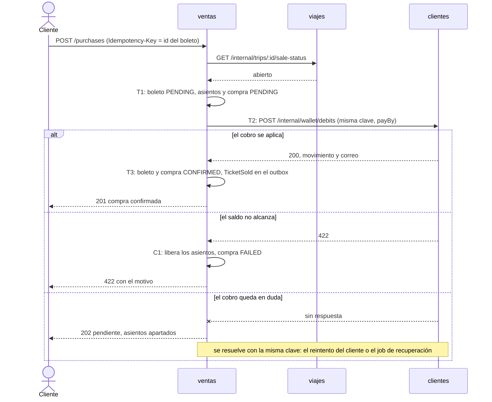

# Manual técnico · Ventas

Boletos, asientos y la compra con la cartera digital. Este manual, por ahora, solo cuenta la **saga de compra**, el **reembolso cuando se elimina un viaje** y el **circuit breaker** de sus dos llamadas a otros servicios; el resto del manual (componentes, tablas, endpoints y eventos) lo completa quien termina el servicio.

## Saga de compra

Comprar un boleto toca tres cosas que no comparten una transacción: los asientos (en la base de `ventas`), el dinero (en la base de `clientes`) y el aviso a los demás servicios (un evento). La saga las ordena para que, pase lo que pase, nunca quede un cobro sin asientos ni asientos apartados para siempre.

La clave es el `Idempotency-Key` de la petición: es un uuid y es **también el id del boleto**. Repetir una petición con la misma clave nunca cobra dos veces.

### Los pasos

| Paso  | Qué hace                                                                                                                                                                   | Tipo en la saga                                                         |
| ----- | -------------------------------------------------------------------------------------------------------------------------------------------------------------------------- | ----------------------------------------------------------------------- |
| Antes | Lee la copia del comprador (`client_nits`), revisa que el circuito hacia `clientes` no esté abierto y le pregunta a `viajes` si el viaje sigue a la venta. No guarda nada. | Verificaciones                                                          |
| T1    | En una sola transacción por lotes crea el boleto `PENDING` con sus asientos y el registro de la compra (`purchases`) `PENDING`.                                            | **Compensable**: si algo falla después, se deshace                      |
| T2    | Cobra en la cartera: `POST /internal/wallet/debits` con `Idempotency-Key` = id del boleto.                                                                                 | **Pivote**: desde que pudo aplicarse ya no se puede deshacer desde aquí |
| T3    | En una transacción confirma el boleto (guarda el correo que devolvió el cobro), pasa la compra a `CONFIRMED` y agrega `TicketSold` al outbox.                              | **Reintentable**: si falla, se repite hasta que salga                   |
| C1    | Compensación de T1: borra el boleto (sus asientos se van en cascada) y pasa la compra a `FAILED` con su motivo.                                                            | Compensación                                                            |

No existe una "compensación del cobro" porque el cobro es el pivote: mientras es dudoso, los asientos **no se liberan** (el dinero pudo haberse movido) y se repite con la misma clave hasta tener una respuesta definitiva.

### Qué pasa con la respuesta del cobro

| Respuesta de `clientes`                                                                                                | Resultado                                                                | Qué hace `ventas`                                                                          | Respuesta al cliente                                                                         |
| ---------------------------------------------------------------------------------------------------------------------- | ------------------------------------------------------------------------ | ------------------------------------------------------------------------------------------ | -------------------------------------------------------------------------------------------- |
| 200 con correo                                                                                                         | Pagado                                                                   | T3                                                                                         | `201`, compra `CONFIRMED` con su boleto                                                      |
| 422                                                                                                                    | Rechazo: saldo insuficiente, o plazo vencido si llegó después de `payBy` | C1                                                                                         | `422` con el texto que mandó `clientes` y "Tus asientos quedaron libres."                    |
| 404 (la cartera aún no existe)                                                                                         | Rechazo                                                                  | C1                                                                                         | `409` "Estamos terminando de preparar tu cuenta"                                             |
| 400 o 409                                                                                                              | Rechazo (no debería pasar) y un error en los logs                        | C1                                                                                         | `409` "No pudimos cobrar esta compra"                                                        |
| Circuito abierto y **ningún** cobro había salido antes                                                                 | Rechazo                                                                  | C1                                                                                         | `503` "No pudimos conectar con tu cartera"                                                   |
| Circuito abierto con un cobro ya enviado antes, timeout, error de red, 5xx, 401/403, cuerpo inválido, o 200 sin correo | **En duda**                                                              | Suelta el `lease`, guarda `last_error` y deja la compra `PENDING` con los asientos tomados | `202`, compra `PENDING`: "Estamos confirmando el pago con tu cartera. No repitas la compra." |

Un 401 o un 403 entre servicios es un problema de configuración, no de la persona: la compra queda pendiente con su `last_error` hasta que se corrija.

### Reglas que sostienen la saga

- **Nunca se cobra sin asientos**: T1 va siempre antes que T2, y antes de cada cobro se comprueba que el boleto `PENDING` siga existiendo. Si ya no existe y nunca salió un cobro, la compra queda `FAILED` con `TRIP_CANCELLED`.
- **`payBy`**: vale lo que ocurra primero entre diez minutos desde que se creó la compra y la salida del viaje. `clientes` revisa primero si el cobro ya se aplicó con esa clave (y entonces responde `200` con el mismo movimiento y el mismo correo) y después el plazo; así un cobro dudoso termina con una respuesta definitiva y no puede aplicarse después de que salió el bus.
- **Lease**: antes de cobrar, la compra se toma con un `locked_until` de 30 segundos y `debit_attempts + 1`. Así la petición del cliente, su reintento y el job de recuperación no cobran la misma compra al mismo tiempo. Quien no obtiene el lease responde con el estado actual de la compra (`202` si sigue `PENDING`).
- **Reintento del cliente con la misma clave**: reanuda desde T2 sin esperar. Si la clave llega con otros datos (otros asientos, otro viaje, otro cliente), responde `409`.
- **Concurrencia**:
  - 20 compras del mismo asiento al mismo tiempo: la clave primaria `(trip_id, seat_number)` deja pasar solo una, y solo esa llama a `clientes`.
  - Dos compras de un cliente que no tiene saldo para ambas: `clientes` bloquea la fila de su cartera, así que una se confirma y la otra se compensa.
  - Dos peticiones con la misma clave: la segunda choca con la clave primaria del boleto, recarga la compra y reanuda.

### Recuperación

`POST /internal/purchases/recover` la llama Cloud Scheduler cada minuto (job `ventas-purchase-recovery`, con la misma identidad OIDC que el flush del outbox; en local la llama `pnpm local` cada 30 s). La protege el guard de Pub/Sub, no sale en Swagger y el gateway bloquea todo lo que empiece con `/internal`.

- Toma hasta 10 compras `PENDING` con más de un minuto sin cambios y sin lease vigente, en orden `updated_at, id`, y repite T2 para cada una. Con el circuito abierto, cada intento falla al instante y la compra sigue pendiente.
- Libera los boletos de ventanilla (`COUNTER`) que llevan más de 30 minutos en `PENDING`: una venta en efectivo se confirma en la misma petición, así que uno pendiente perdió su petición.
- Responde `{ resumed, stillPending, releasedCounterTickets }`.

### Rutas

| Método y ruta              | Roles                                   | Respuesta                                                                              |
| -------------------------- | --------------------------------------- | -------------------------------------------------------------------------------------- |
| `POST /purchases`          | Cualquier sesión                        | `201` compra confirmada, `202` compra pendiente; errores 400, 401, 404, 409, 422 y 503 |
| `GET /purchases/:ticketId` | Cualquier sesión, solo la compra propia | `200` con la compra; la de otra cuenta responde `404`                                  |

El historial de boletos es otra pantalla (`GET /tickets/mine`).

## Viaje eliminado y reembolso

El enunciado pide que eliminar un viaje borre sus boletos y asientos por eventos. Es una **saga coreografiada**: no hay un orquestador ni llamadas síncronas; cada servicio hace su paso al recibir el evento del anterior y anuncia el siguiente. Además, es la **compensación del cobro** de la saga de compra (su paso pivote, que `ventas` no puede deshacer por sí mismo).

| Paso | Servicio   | Tipo                                  | Qué hace                                                                                                 | Idempotencia y recuperación                                                                       |
| ---- | ---------- | ------------------------------------- | -------------------------------------------------------------------------------------------------------- | ------------------------------------------------------------------------------------------------- |
| S1   | `viajes`   | pivote                                | Borra el viaje y publica `TripDeleted` por outbox                                                        | Outbox: si Pub/Sub falla, el flush lo reenvía                                                     |
| S2   | `ventas`   | reintentable                          | Cierra las compras, pide `RefundRequested` y borra la copia del viaje, todo en una transacción del inbox | Inbox por `eventId`; si falla, Pub/Sub reintenta con espera y, al final, dead-letter              |
| S3   | `clientes` | reintentable (compensación del cobro) | Devuelve lo cobrado o deja la marca contra un débito tardío                                              | Inbox por `eventId` y la llave primaria de `refunds` (un reembolso por boleto); mismos reintentos |

Después de S1 todos los pasos son reintentables: siempre terminan, aunque un servicio esté caído un rato, y nunca hace falta deshacer lo anterior.

`ventas` consume `TripDeleted` y, en la misma transacción del inbox:

1. **Cierra las compras en línea del viaje** (`PENDING` y `CONFIRMED`) como `FAILED` con `TRIP_CANCELLED`, y en la misma sentencia lee las que tienen `debit_attempts > 0`: las confirmadas y las que ya enviaron un cobro dudoso. El `UPDATE` bloquea cada compra, así que un intento de cobro que la tomó un instante antes se cuenta, y uno que llega después ya no la encuentra pendiente.
2. **Publica `RefundRequested`** por cada una de esas compras, con el monto, los asientos y el NIT del boleto. Las de `debit_attempts = 0` nunca cobraron, y los boletos de ventanilla (`COUNTER`) se pagaron en efectivo y se devuelven en la ventanilla.
3. **Borra la copia del viaje**: boletos y asientos (en línea y de ventanilla) se van en cascada. La fila de `purchases` se queda, sin llave foránea al viaje, como registro.
4. Si la copia no existía (el `TripDeleted` llegó antes que el `TripScheduled`), guarda el viaje en `deleted_trips` para que un `TripScheduled` tardío no lo ponga a la venta.

`clientes` consume `RefundRequested` y decide si hubo cobro, porque `ventas` no puede saberlo en una compra dudosa:

- Bloquea la fila de la cartera del cliente, el mismo bloqueo que toma un débito.
- Registra la referencia (el id del boleto) en `refunds`. Su llave primaria hace que cada boleto se atienda una sola vez.
- Si existe un débito `TICKET` con esa referencia, devuelve **lo que ese débito cobró** con un movimiento `REFUND` ("Devolución: Boleto …"), que la persona ve en "Movimientos" de su cuenta.
- Si no hubo débito, la fila de `refunds` queda como marca: un débito con esa referencia que llegue después responde `422` ("Este viaje se canceló y ya no se puede pagar.") y no cobra. Como el débito revisa la marca con la cartera bloqueada, un débito y su reembolso nunca se cruzan: o el débito entra primero y se devuelve, o el reembolso entra primero y el débito se rechaza.

Quien consulta una compra cerrada así (`GET /purchases/:ticketId`) recibe `FAILED` con el mensaje "Este viaje se canceló. Si ya se te había cobrado, el dinero vuelve a tu cartera.". Si la compra se estaba pagando en ese momento, la respuesta de la compra es ese mismo mensaje con `409`.

## Circuit breaker

`ventas` hace dos llamadas síncronas, las dos con `ServiceHttpClient` (`packages/server`):

| Llamada                                          | Para qué                         | Timeout y reintentos                                        |
| ------------------------------------------------ | -------------------------------- | ----------------------------------------------------------- |
| `GET /internal/trips/:id/sale-status` a `viajes` | Ver si el viaje sigue a la venta | 3 s, 2 reintentos                                           |
| `POST /internal/wallet/debits` a `clientes`      | Cobrar con la cartera            | 3 s, sin reintentos (reintenta la saga, con la misma clave) |

Cada cliente tiene **un breaker por servicio destino**, con tres estados:

- **Cerrado**: las llamadas salen. Cuenta los intentos fallidos seguidos; al llegar a `CIRCUIT_FAILURE_THRESHOLD` (5) se abre.
- **Abierto**: durante `CIRCUIT_OPEN_MS` (30 s) no sale ninguna llamada y falla al instante con `503` y "Una parte del sistema está fallando y pausamos los intentos unos segundos…".
- **Medio abierto**: pasado ese tiempo sale **una** llamada de prueba. Si funciona, se cierra; si falla, vuelve a abrirse otros 30 s.

Cuenta como falla que no haya respuesta (red, timeout), un `429` o un `5xx`. Un `2xx` y cualquier `4xx` cuentan como éxito, porque el servicio sí respondió. El estado es **por instancia de Cloud Run**, no global. `/health` de cada servicio informa sus circuitos y `/admin/estado` los muestra ("Conexión con Clientes · En pausa hasta 10:32:05").

## Variables de entorno

| Variable                    | Para qué sirve                                                                                                          |
| --------------------------- | ----------------------------------------------------------------------------------------------------------------------- |
| `SERVICE_AUTH`              | `google` en producción: las llamadas a `viajes` y `clientes` llevan token de identidad; `none` en local.                |
| `SERVICE_URL_VIAJES`        | Dirección de `viajes`, para ver si el viaje sigue a la venta (en local, `http://localhost:4003`).                       |
| `SERVICE_URL_CLIENTES`      | Dirección de `clientes`, para cobrar con la cartera (en local, `http://localhost:4005`).                                |
| `CIRCUIT_FAILURE_THRESHOLD` | Fallas seguidas que abren el circuito. Por defecto 5; si falta o no es un entero positivo, se usa el valor por defecto. |
| `CIRCUIT_OPEN_MS`           | Milisegundos que el circuito permanece abierto. Por defecto 30000.                                                      |

En Cloud Run las tres primeras salen de `cloudRunEnv`; en local las trae `services/ventas/.env.example` (quien ya tenía un `.env` agrega esas líneas a mano; sin ellas, comprar responde 503).
