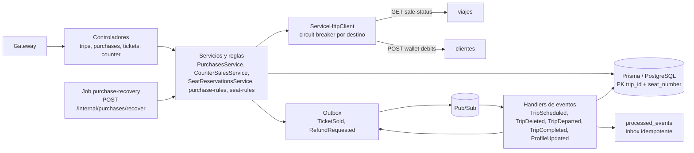
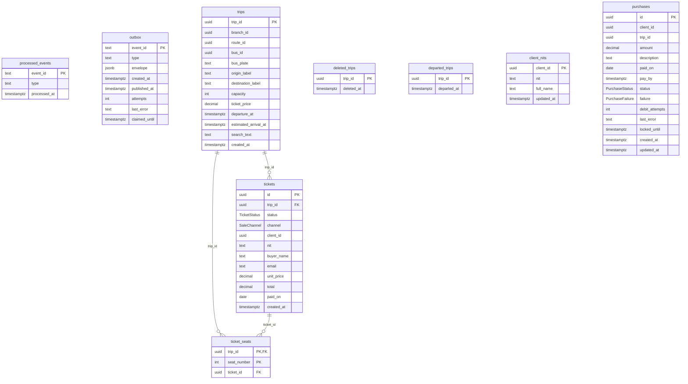
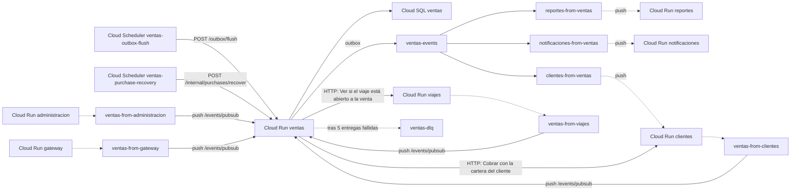
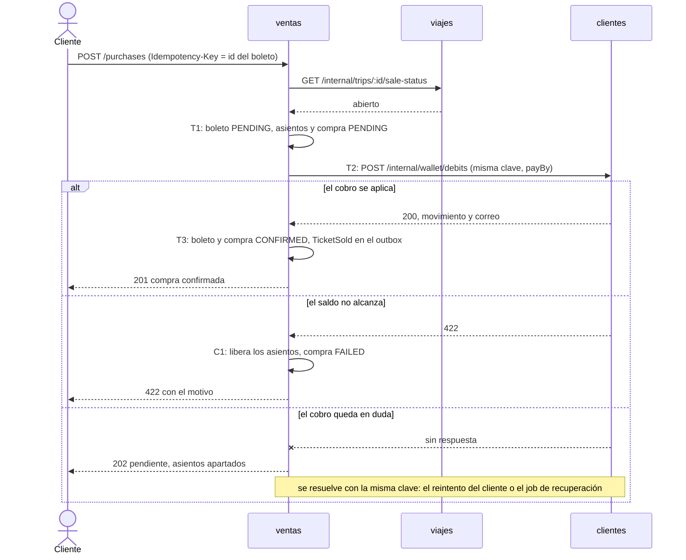

# Manual técnico · Ventas

**Repositorio:** [rrobertobt/sa-debus-ventas](https://github.com/rrobertobt/sa-debus-ventas) (monorepo: [JeffMenca/debus](https://github.com/JeffMenca/debus)).

**Ventas** vende los boletos: muestra los viajes a la venta, aparta los asientos y cobra, ya sea con la cartera del cliente (compra en línea) o en efectivo en la ventanilla de la sucursal. Cada boleto vendido se anuncia con `TicketSold`.

## 1. Para qué sirve y qué reglas cumple

- **Viajes a la venta.** Guarda una copia de cada viaje (`TripScheduled`) con su ruta, su bus, su precio y su capacidad. Un viaje está a la venta hasta su salida programada, o hasta que el bus sale si eso ocurre antes (`TripDeparted`, con `TripCompleted` como respaldo, deja una marca en `departed_trips`), y mientras no se elimine; un viaje que salió ya no aparece en las búsquedas ni en los lugares, y su mapa de asientos, la reserva en línea y la venta en ventanilla responden `409` "Este viaje ya salió"; antes de cobrar, `ventas` le pregunta a `viajes` si sigue abierto (llamada síncrona con circuit breaker). Las búsquedas filtran por origen, destino, día y asientos libres, siempre en el servidor y paginadas.
- **Un asiento se vende una sola vez.** La clave primaria `(trip_id, seat_number)` de `ticket_seats` lo garantiza aunque lleguen muchas compras a la vez: una prueba lanza 20 compras del mismo asiento y exige exactamente un éxito, sin depender del tiempo. Un boleto lleva de 1 a 10 asientos y los asientos de un boleto se guardan o se pierden juntos.
- **Comprar en línea.** `POST /purchases` con la `Idempotency-Key` igual al id del boleto: es una **saga orquestada** (reservar, cobrar a `clientes`, confirmar) con compensación y recuperación. Los pasos están en [Saga de compra](#saga-de-compra).
- **Vender en ventanilla.** `POST /counter/tickets` lo usan el cajero y el admin de la sucursal, solo para viajes que salen de su sucursal. El dinero ya está en el mostrador, así que aparta los asientos y confirma en la misma petición; la clave es también el id del boleto, y repetirla responde el mismo boleto. Si el comprador da un NIT que es de un cliente, la venta queda en el historial de esa persona (copia `client_nits`, de `ProfileUpdated`); sin NIT, es consumidor final (`CF`).
- **Historial.** `GET /tickets` lista los boletos del cliente (en línea y los de ventanilla con su NIT), con el próximo viaje, paginado en el servidor.
- **Fechas.** Todo pago lleva `paidOn`, la fecha de pago que la persona puede elegir (hoy por defecto); los reportes de ingresos se fechan con ella. Por eso los datos de demostración pueden llevar un pago fechado días antes de la compra (se reparten en los 14 días anteriores a la carga): es una decisión de esos datos, no una regla del producto.
- **Viaje eliminado.** Al recibir `TripDeleted` cierra las compras, devuelve el dinero por eventos y borra los boletos y asientos del viaje: [Viaje eliminado y reembolso](#viaje-eliminado-y-reembolso).
- **Copias por eventos.** Guarda la copia de los viajes (`trips`, más `deleted_trips` para los que se eliminaron antes de llegar y `departed_trips` para los que ya salieron) y la de los NIT de los clientes (`client_nits`), siempre por versión.

## 2. Diagrama de componentes



## 3. Diagrama de tablas

Ventas guarda la copia de los viajes, los boletos con sus asientos, el registro de cada compra con la cartera (`purchases`, que sobrevive aunque el boleto se borre), la copia de los NIT de los clientes y las tablas del outbox y del inbox. `purchases` es el estado persistido de la saga: guarda su estado, el intento de cobro, el plazo `pay_by` y el `locked_until` del lease.

<!-- prettier-ignore-start -->
<!-- generado:tablas -->

<!-- /generado:tablas -->
<!-- prettier-ignore-end -->

## 4. Diagrama de despliegue

Cada servicio corre en su propio Cloud Run con su propia base en Cloud SQL; los eventos viajan por Pub/Sub y las llamadas síncronas de `ventas` (a `clientes` y a `viajes`) por HTTP con el token de identidad de la cuenta de servicio. Cloud Scheduler llama cada minuto a `ventas-outbox-flush` y a `ventas-purchase-recovery`.

<!-- prettier-ignore-start -->
<!-- generado:despliegue -->

<!-- /generado:despliegue -->
<!-- prettier-ignore-end -->

## 5. Eventos y manejo de fallos

El outbox se escribe en la misma transacción que el boleto (o el cierre de la compra) y lo publican el job `ventas-outbox-flush` (cada minuto) y el propio servicio al terminar la petición; el inbox (`processed_events`) evita procesar dos veces una entrega; Pub/Sub reintenta y, tras 5 fallos, deja el mensaje en `ventas-dlq`. Dos sagas pasan por este servicio y se cuentan con los términos del patrón: la compra con la cartera (**orquestada**, con llamadas síncronas) y el reembolso por un viaje eliminado (**coreografiada**, solo eventos).

### Saga de compra

Comprar un boleto toca tres cosas que no comparten una transacción: los asientos (en la base de `ventas`), el dinero (en la base de `clientes`) y el aviso a los demás servicios (un evento). La saga las ordena para que, pase lo que pase, nunca quede un cobro sin asientos ni asientos apartados para siempre.

La clave es el `Idempotency-Key` de la petición: es un uuid y es **también el id del boleto**. Repetir una petición con la misma clave nunca cobra dos veces.

#### Los pasos

| Paso  | Qué hace                                                                                                                                                                   | Tipo en la saga                                                         |
| ----- | -------------------------------------------------------------------------------------------------------------------------------------------------------------------------- | ----------------------------------------------------------------------- |
| Antes | Lee la copia del comprador (`client_nits`), revisa que el circuito hacia `clientes` no esté abierto y le pregunta a `viajes` si el viaje sigue a la venta. No guarda nada. | Verificaciones                                                          |
| T1    | En una sola transacción por lotes crea el boleto `PENDING` con sus asientos y el registro de la compra (`purchases`) `PENDING`.                                            | **Compensable**: si algo falla después, se deshace                      |
| T2    | Cobra en la cartera: `POST /internal/wallet/debits` con `Idempotency-Key` = id del boleto.                                                                                 | **Pivote**: desde que pudo aplicarse ya no se puede deshacer desde aquí |
| T3    | En una transacción confirma el boleto (guarda el correo que devolvió el cobro), pasa la compra a `CONFIRMED` y agrega `TicketSold` al outbox.                              | **Reintentable**: si falla, se repite hasta que salga                   |
| C1    | Compensación de T1: borra el boleto (sus asientos se van en cascada) y pasa la compra a `FAILED` con su motivo.                                                            | Compensación                                                            |

No existe una "compensación del cobro" porque el cobro es el pivote: mientras es dudoso, los asientos **no se liberan** (el dinero pudo haberse movido) y se repite con la misma clave hasta tener una respuesta definitiva.



#### Qué pasa con la respuesta del cobro

| Respuesta de `clientes`                                                                                                | Resultado                                                                | Qué hace `ventas`                                                                          | Respuesta al cliente                                                                         |
| ---------------------------------------------------------------------------------------------------------------------- | ------------------------------------------------------------------------ | ------------------------------------------------------------------------------------------ | -------------------------------------------------------------------------------------------- |
| 200 con correo                                                                                                         | Pagado                                                                   | T3                                                                                         | `201`, compra `CONFIRMED` con su boleto                                                      |
| 422                                                                                                                    | Rechazo: saldo insuficiente, o plazo vencido si llegó después de `payBy` | C1                                                                                         | `422` con el texto que mandó `clientes` y "Tus asientos quedaron libres."                    |
| 404 (la cartera aún no existe)                                                                                         | Rechazo                                                                  | C1                                                                                         | `409` "Estamos terminando de preparar tu cuenta"                                             |
| 400 o 409                                                                                                              | Rechazo (no debería pasar) y un error en los logs                        | C1                                                                                         | `409` "No pudimos cobrar esta compra"                                                        |
| Circuito abierto y **ningún** cobro había salido antes                                                                 | Rechazo                                                                  | C1                                                                                         | `503` "No pudimos conectar con tu cartera"                                                   |
| Circuito abierto con un cobro ya enviado antes, timeout, error de red, 5xx, 401/403, cuerpo inválido, o 200 sin correo | **En duda**                                                              | Suelta el `lease`, guarda `last_error` y deja la compra `PENDING` con los asientos tomados | `202`, compra `PENDING`: "Estamos confirmando el pago con tu cartera. No repitas la compra." |

Un 401 o un 403 entre servicios es un problema de configuración, no de la persona: la compra queda pendiente con su `last_error` hasta que se corrija.

#### Reglas que sostienen la saga

- **Nunca se cobra sin asientos**: T1 va siempre antes que T2, y antes de cada cobro se comprueba que el boleto `PENDING` siga existiendo. Si ya no existe y nunca salió un cobro, la compra queda `FAILED` con `TRIP_CANCELLED`.
- **`payBy`**: vale lo que ocurra primero entre diez minutos desde que se creó la compra y la salida del viaje. `clientes` revisa primero si el cobro ya se aplicó con esa clave (y entonces responde `200` con el mismo movimiento y el mismo correo) y después el plazo; así un cobro dudoso termina con una respuesta definitiva y no puede aplicarse después de que salió el bus.
- **Lease**: antes de cobrar, la compra se toma con un `locked_until` de 30 segundos y `debit_attempts + 1`. Así la petición del cliente, su reintento y el job de recuperación no cobran la misma compra al mismo tiempo. Quien no obtiene el lease responde con el estado actual de la compra (`202` si sigue `PENDING`).
- **Reintento del cliente con la misma clave**: reanuda desde T2 sin esperar. Si la clave llega con otros datos (otros asientos, otro viaje, otro cliente), responde `409`.
- **Concurrencia**:
  - 20 compras del mismo asiento al mismo tiempo: la clave primaria `(trip_id, seat_number)` deja pasar solo una, y solo esa llama a `clientes`.
  - Dos compras de un cliente que no tiene saldo para ambas: `clientes` bloquea la fila de su cartera, así que una se confirma y la otra se compensa.
  - Dos peticiones con la misma clave: la segunda choca con la clave primaria del boleto, recarga la compra y reanuda.

#### Recuperación

`POST /internal/purchases/recover` la llama Cloud Scheduler cada minuto (job `ventas-purchase-recovery`, con la misma identidad OIDC que el flush del outbox; en local la llama `pnpm local` cada 30 s). La protege el guard de Pub/Sub, no sale en Swagger y el gateway bloquea todo lo que empiece con `/internal`.

- Toma hasta 10 compras `PENDING` con más de un minuto sin cambios y sin lease vigente, en orden `updated_at, id`, y repite T2 para cada una. Con el circuito abierto, cada intento falla al instante y la compra sigue pendiente.
- Libera los boletos de ventanilla (`COUNTER`) que llevan más de 30 minutos en `PENDING`: una venta en efectivo se confirma en la misma petición, así que uno pendiente perdió su petición.
- Responde `{ resumed, stillPending, releasedCounterTickets }`.

#### Rutas

| Método y ruta              | Roles                                   | Respuesta                                                                              |
| -------------------------- | --------------------------------------- | -------------------------------------------------------------------------------------- |
| `POST /purchases`          | Cualquier sesión                        | `201` compra confirmada, `202` compra pendiente; errores 400, 401, 404, 409, 422 y 503 |
| `GET /purchases/:ticketId` | Cualquier sesión, solo la compra propia | `200` con la compra; la de otra cuenta responde `404`                                  |

El historial de boletos es otra pantalla (`GET /tickets`).

#### Lo que ve el cliente

La pantalla de asientos (`/viajes/<viaje>/asientos`) muestra cada desenlace con el `message` que manda `ventas`, sin cambiarlo. La clave de la compra se reutiliza solo cuando la respuesta no llegó (error de red); cualquier respuesta del servidor la gasta y el siguiente intento usa una nueva.

| Respuesta                                                            | Paso de la saga                                        | Pantalla                                                                                                    |
| -------------------------------------------------------------------- | ------------------------------------------------------ | ----------------------------------------------------------------------------------------------------------- |
| `201`                                                                | T3                                                     | Recibo del boleto                                                                                           |
| `202` y después `CONFIRMED` (consulta `GET /purchases/:id` cada 3 s) | pivote en duda, luego T3                               | "Pago en confirmación" y después el recibo                                                                  |
| `202` y después `FAILED`                                             | C1                                                     | Vuelve al formulario con el motivo; el mapa se recarga                                                      |
| `202` o `409` y la compra queda `FAILED` / `TRIP_CANCELLED`          | el viaje se eliminó (saga de reembolso)                | "Viaje cancelado": no vuelve a pedir el mapa y ofrece buscar otro viaje o ver los movimientos de la cartera |
| `409` sin compra cancelada, o `422`                                  | antes de T1, o C1                                      | El formulario con el motivo; el mapa se recarga                                                             |
| `404`                                                                | el viaje dejó de venderse antes de T1                  | "No encontramos ese viaje"                                                                                  |
| `503`                                                                | circuito abierto o servicio sin respuesta, antes de T2 | El formulario con el motivo ("no se te cobró nada"); el mapa no cambia                                      |

El cuerpo de error solo trae el texto, así que para saber si un `409` es una cancelación la pantalla lee la compra con la misma clave: si existe y está `FAILED` / `TRIP_CANCELLED`, el viaje se eliminó durante el pago. El texto de pausa del circuit breaker de `@debus/server` no llega a esta pantalla: `ventas` responde con sus propios mensajes de cartera o de viajes sin respuesta.

En "Mis boletos" de `/cuenta`, el boleto de un viaje eliminado desaparece y la devolución aparece en "Movimientos"; una nota bajo la lista lo explica.

### Viaje eliminado y reembolso

El enunciado pide que eliminar un viaje borre sus boletos y asientos por eventos. Es una **saga coreografiada**: no hay un orquestador ni llamadas síncronas; cada servicio hace su paso al recibir el evento del anterior y anuncia el siguiente. Además, es la **compensación del cobro** de la saga de compra (su paso pivote, que `ventas` no puede deshacer por sí mismo).

| Paso | Servicio         | Tipo                                  | Qué hace                                                                                                 | Idempotencia y recuperación                                                                       |
| ---- | ---------------- | ------------------------------------- | -------------------------------------------------------------------------------------------------------- | ------------------------------------------------------------------------------------------------- |
| S1   | `viajes`         | pivote                                | Borra el viaje y publica `TripDeleted` por outbox                                                        | Outbox: si Pub/Sub falla, el flush lo reenvía                                                     |
| S2   | `ventas`         | reintentable                          | Cierra las compras, pide `RefundRequested` y borra la copia del viaje, todo en una transacción del inbox | Inbox por `eventId`; si falla, Pub/Sub reintenta con espera y, al final, dead-letter              |
| S3   | `clientes`       | reintentable (compensación del cobro) | Devuelve lo cobrado o deja la marca contra un débito tardío                                              | Inbox por `eventId` y la llave primaria de `refunds` (un reembolso por boleto); mismos reintentos |
| S4   | `notificaciones` | reintentable                          | Avisa a cada comprador con correo y, con `WalletCredited`, confirma la devolución ya acreditada          | Inbox por `eventId` y la clave única de `sent_emails` (un correo por boleto); la cola reintenta   |

Después de S1 todos los pasos son reintentables: siempre terminan, aunque un servicio esté caído un rato, y nunca hace falta deshacer lo anterior.

`ventas` consume `TripDeleted` y, en la misma transacción del inbox:

1. **Cierra las compras en línea del viaje** (`PENDING` y `CONFIRMED`) como `FAILED` con `TRIP_CANCELLED`, y en la misma sentencia lee las que tienen `debit_attempts > 0`: las confirmadas y las que ya enviaron un cobro dudoso. El `UPDATE` bloquea cada compra, así que un intento de cobro que la tomó un instante antes se cuenta, y uno que llega después ya no la encuentra pendiente.
2. **Publica `RefundRequested`** por cada una de esas compras, con el monto, los asientos y el NIT del boleto. Las de `debit_attempts = 0` nunca cobraron, y los boletos de ventanilla (`COUNTER`) se pagaron en efectivo y se devuelven en la ventanilla.
3. **Borra la copia del viaje**: boletos y asientos (en línea y de ventanilla) se van en cascada. La fila de `purchases` se queda, sin llave foránea al viaje, como registro.
4. Si la copia no existía (el `TripDeleted` llegó antes que el `TripScheduled`), guarda el viaje en `deleted_trips` para que un `TripScheduled` tardío no lo ponga a la venta.

`clientes` consume `RefundRequested` y decide si hubo cobro, porque `ventas` no puede saberlo en una compra dudosa:

- Bloquea la fila de la cartera del cliente, el mismo bloqueo que toma un débito.
- Registra la referencia (el id del boleto) en `refunds`. Su llave primaria hace que cada boleto se atienda una sola vez.
- Si existe un débito `TICKET` con esa referencia, devuelve **lo que ese débito cobró** con un movimiento `REFUND` ("Devolución: Boleto …"), que la persona ve en "Movimientos" de su cuenta.
- Si no hubo débito, la fila de `refunds` queda como marca: un débito con esa referencia que llegue después responde `422` ("Este viaje se canceló y ya no se puede pagar.") y no cobra. Como el débito revisa la marca con la cartera bloqueada, un débito y su reembolso nunca se cruzan: o el débito entra primero y se devuelve, o el reembolso entra primero y el débito se rechaza.

Quien consulta una compra cerrada así (`GET /purchases/:ticketId`) recibe `FAILED` con el mensaje "Este viaje se canceló. Si ya se te había cobrado, el dinero vuelve a tu cartera.". Si la compra se estaba pagando en ese momento, la respuesta de la compra es ese mismo mensaje con `409`.

### Circuit breaker

`ventas` hace dos llamadas síncronas, las dos con `ServiceHttpClient` (`packages/server`):

| Llamada                                          | Para qué                         | Timeout y reintentos                                        |
| ------------------------------------------------ | -------------------------------- | ----------------------------------------------------------- |
| `GET /internal/trips/:id/sale-status` a `viajes` | Ver si el viaje sigue a la venta | 3 s, 2 reintentos                                           |
| `POST /internal/wallet/debits` a `clientes`      | Cobrar con la cartera            | 3 s, sin reintentos (reintenta la saga, con la misma clave) |

Cada cliente tiene **un breaker por servicio destino**, con tres estados:

- **Cerrado**: las llamadas salen. Cuenta los intentos fallidos seguidos; al llegar a `CIRCUIT_FAILURE_THRESHOLD` (5) se abre.
- **Abierto**: durante `CIRCUIT_OPEN_MS` (30 s) no sale ninguna llamada y falla al instante con `503` y "Una parte del sistema está fallando y pausamos los intentos unos segundos…".
- **Medio abierto**: pasado ese tiempo sale **una** llamada de prueba. Si funciona, se cierra; si falla, vuelve a abrirse otros 30 s.

Cuenta como falla que no haya respuesta (red, timeout), un `429` o un `5xx`. Un `2xx` y cualquier `4xx` cuentan como éxito, porque el servicio sí respondió. El estado es **por instancia de Cloud Run**, no global. `/health` de cada servicio informa sus circuitos y `/admin/estado` los muestra ("Conexión con Clientes · En pausa hasta 10:32:05").

<!-- prettier-ignore-start -->
<!-- generado:eventos -->
**Publica**

| Evento | Lo consumen |
| --- | --- |
| `TicketSold` | reportes, notificaciones, clientes |
| `RefundRequested` | clientes |

**Consume**

| Evento | Lo publica |
| --- | --- |
| `BranchCreated` | administracion |
| `BranchUpdated` | administracion |
| `TripScheduled` | viajes |
| `TripDeleted` | viajes |
| `TripDeparted` | viajes |
| `TripCompleted` | viajes |
| `ProfileUpdated` | clientes |
| `ProbeSent` | gateway |
<!-- /generado:eventos -->
<!-- prettier-ignore-end -->

## 6. Endpoints

Todas las rutas pasan por el gateway con el prefijo `/api/ventas` (aquí aparecen sin él). El detalle de cada cuerpo y respuesta está en el Swagger del gateway (`/docs`; en local, `http://localhost:4000/docs`) y en la colección [`postman/debus.postman_collection.json`](../../postman/debus.postman_collection.json). Las rutas internas (`/internal/purchases/recover`) no salen por el gateway ni en Swagger: las llama Cloud Scheduler con el token OIDC de `pubsub-invoker`.

<!-- prettier-ignore-start -->
<!-- generado:endpoints -->
| Método | Ruta | Qué hace | Roles |
| --- | --- | --- | --- |
| `POST` | `/counter/tickets` | Vende boletos en efectivo en la ventanilla (la clave es el id del boleto) | BRANCH_ADMIN, CASHIER |
| `GET` | `/counter/trips` | Lista los viajes de la sucursal que están a la venta en ventanilla | BRANCH_ADMIN, CASHIER |
| `GET` | `/dead-letters` | Lista los mensajes que fallaron y quedaron en la cola de errores | SYSTEM_ADMIN |
| `DELETE` | `/dead-letters/{messageId}` | Descarta un mensaje de la cola de errores | SYSTEM_ADMIN |
| `POST` | `/dead-letters/{messageId}/replay` | Vuelve a entregar un mensaje de la cola de errores | SYSTEM_ADMIN |
| `GET` | `/health` | Responde si el servicio está en línea | Cualquier sesión |
| `POST` | `/purchases` | Compra boletos con la cartera (la clave es el id del boleto); responde 202 si el cobro sigue en duda | Cualquier sesión |
| `GET` | `/purchases/{ticketId}` | Consulta una compra propia: confirmada, pendiente o fallida | Cualquier sesión |
| `GET` | `/tickets` | Lista los boletos del cliente, con el próximo viaje | CLIENT |
| `GET` | `/trips` | Lista los viajes a la venta, con sus asientos libres | SYSTEM_ADMIN, BRANCH_ADMIN, CASHIER, DRIVER, CLIENT |
| `GET` | `/trips/places` | Lista los lugares de salida y de llegada de los viajes a la venta | SYSTEM_ADMIN, BRANCH_ADMIN, CASHIER, DRIVER, CLIENT |
| `GET` | `/trips/{tripId}/seats` | Muestra los asientos ocupados de un viaje | SYSTEM_ADMIN, BRANCH_ADMIN, CASHIER, DRIVER, CLIENT |
<!-- /generado:endpoints -->
<!-- prettier-ignore-end -->

## 7. Variables de entorno

Las que recibe en Cloud Run salen de `cloudRunEnv` (`packages/contracts/src/cloud-run-env.ts`); en local las trae `services/ventas/.env.example` (quien ya tenía un `.env` agrega esas líneas a mano; sin ellas, comprar responde 503).

| Variable                    | Para qué sirve                                                                                                          |
| --------------------------- | ----------------------------------------------------------------------------------------------------------------------- |
| `PORT`                      | Puerto en el que escucha (el de su `.env.example` en local; Cloud Run lo asigna en producción).                         |
| `SERVICE_NAME`              | Nombre del servicio; lo fija el despliegue y el código no lo lee.                                                       |
| `DEBUS_ENV`                 | `local` o `production`.                                                                                                 |
| `PUBSUB_PROJECT_ID`         | Proyecto de Pub/Sub (en local, el del emulador `debus-local`).                                                          |
| `PUBSUB_AUDIENCE`           | Dirección del servicio: el token OIDC que Pub/Sub manda en cada entrega debe estar emitido para ella.                   |
| `PUBSUB_PUSH_SA`            | Cuenta de servicio que Pub/Sub usa para entregar y que Cloud Scheduler usa para el flush y la recuperación.             |
| `PUBSUB_EMULATOR_HOST`      | Solo en local: con él no se valida el token de Pub/Sub.                                                                 |
| `DATABASE_URL`              | Conexión a la base del servicio (en producción la arma el despliegue).                                                  |
| `DB_POOL_MAX`               | Conexiones máximas al pool (2 en Cloud Run, para no agotar Cloud SQL).                                                  |
| `SERVICE_AUTH`              | `google` en producción: las llamadas a `viajes` y `clientes` llevan token de identidad; `none` en local.                |
| `SERVICE_URL_VIAJES`        | Dirección de `viajes`, para ver si el viaje sigue a la venta (en local, `http://localhost:4003`).                       |
| `SERVICE_URL_CLIENTES`      | Dirección de `clientes`, para cobrar con la cartera (en local, `http://localhost:4005`).                                |
| `CIRCUIT_FAILURE_THRESHOLD` | Fallas seguidas que abren el circuito. Por defecto 5; si falta o no es un entero positivo, se usa el valor por defecto. |
| `CIRCUIT_OPEN_MS`           | Milisegundos que el circuito permanece abierto. Por defecto 30000.                                                      |

## 8. Cómo correrlo y probarlo

```bash
pnpm install
pnpm local                                    # todo el stack: PostgreSQL, Pub/Sub, Mailpit, apps y migraciones
pnpm --filter @debus/ventas test               # pruebas unitarias con cobertura (mínimo 85 %)
pnpm --filter @debus/ventas test:integration   # contra PostgreSQL y el emulador de Pub/Sub (mínimo 65 %)
pnpm seed                                      # boletos en línea y de ventanilla de demostración
```

- Para comprar hacen falta `viajes` y `clientes`; sin `clientes` la compra responde 503 con "No pudimos conectar con tu cartera" y no se cobra nada. Con el servicio caído el circuito se abre a la quinta falla seguida y la integración lo comprueba.
- La prueba de concurrencia lanza 20 compras del mismo asiento y exige exactamente un éxito y un solo cobro; no depende del tiempo.
- Las pruebas que escriben datos usan correos `@debus.test` y los borran al terminar; `pnpm test:clean` quita lo que haya quedado. Los boletos del seed no son datos de prueba y no se borran.
- Recuperar a mano las compras en duda: `curl -X POST http://localhost:4004/internal/purchases/recover` (en local lo hace cada 30 s el ciclo de `pnpm local`).
