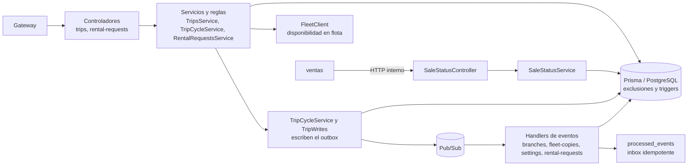
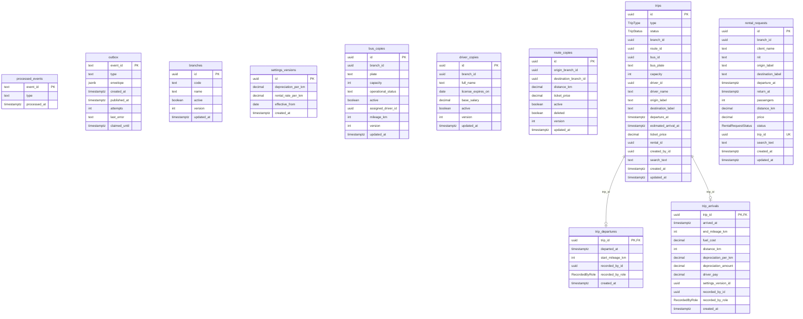
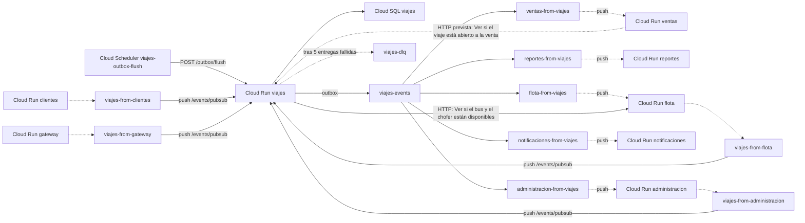

# Manual técnico · Viajes

**Viajes** programa los viajes de cada sucursal, registra su salida y su llegada y asigna bus y chofer a los alquileres que paga el cliente.

## 1. Para qué sirve y qué reglas cumple

- **Programar.** Un viaje une una ruta de la sucursal, un bus y un chofer; antes de guardarlo consulta a `flota` si pueden hacerlo (llamada HTTP síncrona, con 502/503 si no responde). Dos exclusiones de PostgreSQL impiden que un bus o un chofer tengan dos viajes en el mismo horario; el viaje con su llegada registrada libera ambos.
- **Salida y llegada.** Se registran una sola vez y son **inmutables** (trigger de PostgreSQL, sin `PUT`, `PATCH` ni `DELETE`): la salida admite como mucho 12 horas de anticipación y no puede ser futura (con 5 minutos de tolerancia); la llegada va después de la salida con kilometraje final y combustible. Al completarse, la depreciación (km recorridos por la depreciación vigente ese día) y el pago del chofer quedan fijados en el viaje. Un viaje que no ha salido se puede eliminar (`TripDeleted`).
- **Alquileres.** Cuando `clientes` publica `RentalPaid`, la solicitud queda pendiente; el admin de la sucursal la asigna a un bus con asientos suficientes y a un chofer, y se programa el viaje de alquiler con el pago al chofer 15 % mayor.
- **Venta.** `GET /internal/trips/:id/sale-status` (solo entre servicios) dirá a `ventas` si el viaje está abierto a la venta; la ruta ya existe y `ventas` aún no la usa.
- **Copias por eventos.** Guarda la copia de sucursales, buses, choferes, rutas y la configuración vigente con sus fechas, siempre por versión.

## 2. Diagrama de componentes



## 3. Diagrama de tablas

Viajes guarda los viajes con sus registros de salida y llegada, las solicitudes de alquiler y las copias de sucursales, buses, choferes, rutas y configuración, más las tablas del outbox y del inbox.

<!-- prettier-ignore-start -->
<!-- generado:tablas -->

<!-- /generado:tablas -->
<!-- prettier-ignore-end -->

## 4. Diagrama de despliegue

Cada servicio corre en su propio Cloud Run; los eventos viajan por Pub/Sub y las pocas llamadas síncronas por HTTP con el token de identidad de la cuenta de servicio.

<!-- prettier-ignore-start -->
<!-- generado:despliegue -->

<!-- /generado:despliegue -->
<!-- prettier-ignore-end -->

## 5. Eventos y manejo de fallos

El outbox se escribe en la misma transacción que el viaje y lo publican el job `viajes-outbox-flush` (cada minuto) y el propio servicio; el inbox (`processed_events`) evita procesar dos veces una entrega; Pub/Sub reintenta y, tras 5 fallos, deja el mensaje en `viajes-dlq`. Si la copia de un bus o de un chofer aún no llegó, programar contesta "Estamos terminando de registrar ese bus" y se reintenta en unos segundos; si `flota` no responde, 502 o 503 sin guardar nada.

<!-- prettier-ignore-start -->
<!-- generado:eventos -->
**Publica**

| Evento | Lo consumen |
| --- | --- |
| `TripScheduled` | ventas, reportes, flota |
| `TripDeleted` | ventas, notificaciones, flota, reportes |
| `TripDeparted` | flota, reportes |
| `TripCompleted` | administracion, flota, reportes |

**Consume**

| Evento | Lo publica |
| --- | --- |
| `BranchCreated` | administracion |
| `BranchUpdated` | administracion |
| `SettingsUpdated` | administracion |
| `BusAdded` | flota |
| `BusUpdated` | flota |
| `BusDeactivated` | flota |
| `DriverAdded` | flota |
| `DriverUpdated` | flota |
| `RouteCreated` | flota |
| `RouteUpdated` | flota |
| `RouteDeleted` | flota |
| `RentalPaid` | clientes |
| `ProbeSent` | gateway |
<!-- /generado:eventos -->
<!-- prettier-ignore-end -->

## 6. Endpoints

Todas las rutas pasan por el gateway con el prefijo `/api/viajes` (aquí aparecen sin él). El detalle de cada cuerpo y respuesta está en el Swagger del gateway (`/docs`; en local, `http://localhost:4000/docs`) y en la colección [`postman/debus.postman_collection.json`](../../postman/debus.postman_collection.json).

<!-- prettier-ignore-start -->
<!-- generado:endpoints -->
| Método | Ruta | Qué hace | Roles |
| --- | --- | --- | --- |
| `GET` | `/dead-letters` | Lista los mensajes que fallaron y quedaron en la cola de errores | SYSTEM_ADMIN |
| `DELETE` | `/dead-letters/{messageId}` | Descarta un mensaje de la cola de errores | SYSTEM_ADMIN |
| `POST` | `/dead-letters/{messageId}/replay` | Vuelve a entregar un mensaje de la cola de errores | SYSTEM_ADMIN |
| `GET` | `/health` | Responde si el servicio está en línea | Cualquier sesión |
| `GET` | `/rental-requests` | Lista las solicitudes de alquiler | BRANCH_ADMIN |
| `POST` | `/rental-requests/{id}/assignment` | Asigna bus y chofer a un alquiler y programa su viaje | BRANCH_ADMIN |
| `GET` | `/trips` | Lista los viajes | BRANCH_ADMIN, DRIVER |
| `POST` | `/trips` | Programa un viaje | BRANCH_ADMIN |
| `GET` | `/trips/{id}` | Consulta un viaje con su salida y su llegada | BRANCH_ADMIN, DRIVER |
| `DELETE` | `/trips/{id}` | Elimina un viaje que no ha salido | BRANCH_ADMIN |
| `POST` | `/trips/{id}/arrival` | Registra la llegada de un viaje | BRANCH_ADMIN, DRIVER |
| `POST` | `/trips/{id}/departure` | Registra la salida de un viaje | BRANCH_ADMIN, DRIVER |
<!-- /generado:endpoints -->
<!-- prettier-ignore-end -->

## 7. Variables de entorno

Las que recibe en Cloud Run salen de `cloudRunEnv` (`packages/contracts/src/cloud-run-env.ts`); en local las trae `services/viajes/.env.example`.

| Variable               | Para qué sirve                                                                                        |
| ---------------------- | ----------------------------------------------------------------------------------------------------- |
| `PORT`                 | Puerto en el que escucha (el de su `.env.example` en local; Cloud Run lo asigna en producción).       |
| `SERVICE_NAME`         | Nombre del servicio; lo fija el despliegue y el código no lo lee.                                     |
| `DEBUS_ENV`            | `local` o `production`.                                                                               |
| `PUBSUB_PROJECT_ID`    | Proyecto de Pub/Sub (en local, el del emulador `debus-local`).                                        |
| `PUBSUB_AUDIENCE`      | Dirección del servicio: el token OIDC que Pub/Sub manda en cada entrega debe estar emitido para ella. |
| `PUBSUB_PUSH_SA`       | Cuenta de servicio que Pub/Sub usa para entregar; solo ella puede llamar a `POST /events/pubsub`.     |
| `PUBSUB_EMULATOR_HOST` | Solo en local: con él no se valida el token de Pub/Sub.                                               |
| `DATABASE_URL`         | Conexión a la base del servicio (en producción la arma el despliegue).                                |
| `DB_POOL_MAX`          | Conexiones máximas al pool (2 en Cloud Run, para no agotar Cloud SQL).                                |
| `SERVICE_AUTH`         | `google` en producción: la llamada a `flota` lleva token de identidad.                                |
| `SERVICE_URL_FLOTA`    | Dirección de `flota`, para consultar la disponibilidad.                                               |

## 8. Cómo correrlo y probarlo

```bash
pnpm install
pnpm local                                   # todo el stack: PostgreSQL, Pub/Sub, Mailpit, apps y migraciones
pnpm --filter @debus/viajes test              # pruebas unitarias con cobertura (mínimo 85 %)
pnpm --filter @debus/viajes test:integration  # contra PostgreSQL y el emulador de Pub/Sub (mínimo 65 %)
```

Para programar viajes hace falta que `flota` también corra (`pnpm local` levanta todo).

Las pruebas que escriben datos usan correos `@debus.test` y el prefijo `Prueba ` y los borran al terminar; `pnpm test:clean` quita lo que haya quedado.
